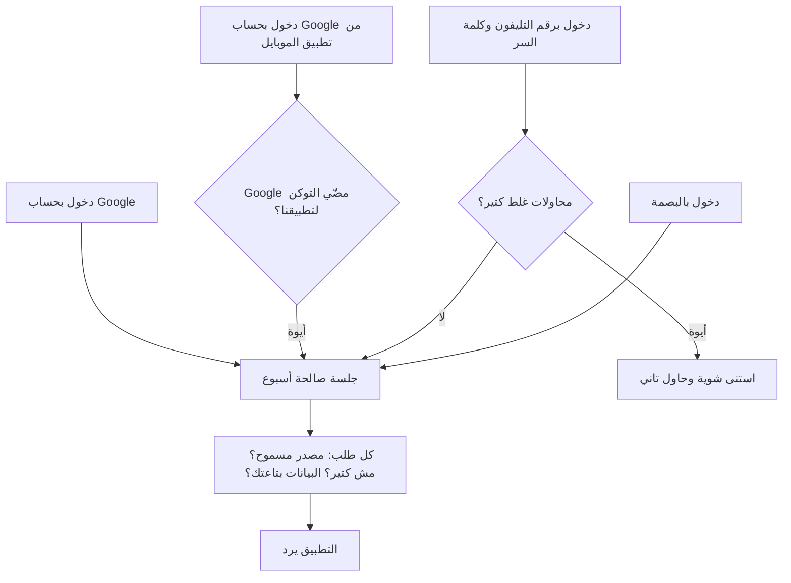

# الحسابات وتسجيل الدخول والأمان

> الصفحة دي بتشرح من غير كود إزاي بتدخل التطبيق، وإزاي بيفضل فاكرك، وإزاي بيحمي حسابك وبياناتك. الشرح الهندسي
> بالتفصيل في [الصفحة الإنجليزي](../../systems/accounts.md)، والرسومات المتولّدة من الكود في
> [صفحة الحقائق](../../atlas/systems/accounts.md).

## النظام ده بيعمل إيه
- **طرق الدخول**: بحساب Google، أو برقم التليفون وكلمة سر، أو بالبصمة (passkey) بعد ما تسجلها.
- **تطبيق الموبايل الجديد** (Flutter): بتدخل فيه برقم التليفون وكلمة السر، أو تعمل حساب جديد وتأكّد رقمك من الواتساب، أو
  تدخل بحساب Google من الموبايل نفسه.
- **بيفضل فاكرك**: بعد الدخول بتفضل داخل لمدة أسبوع، أو لحد ما تسجل خروج.
- **قفل التطبيق**: تقدر تقفل التطبيق على موبايلك ببصمة أو رقم سري من 4 أرقام.
- **الحماية**: كل طلب بيوصل للسيرفر بيعدي على فحوصات قبل ما يتنفذ.
- **ملفك**: بيعرض دخلك والتزاماتك الثابتة، و«يفضل كام من الدخل بعد الالتزامات» (ده مش ادخار: مصاريفك مش داخلة فيه)،
  وقد إيه الملف كامل، من غير ما يقول إن التقارير بقت «أدق» بسببه.
- **الخروج من كل الأجهزة أو تغيير الباسورد** بيوقّف كمان مفاتيح الموبايلات اللي بتبعت رسايل البنك.
- **مسح الحساب**: من «حذف الحساب» في ملفك تقدر تمسح حسابك بنفسك: تكتب «احذف حسابي»، ولو حسابك بالموبايل تكتب الباسورد
  كمان. كل بياناتك بتتمسح معاه، ومنها سجل مكالماتك الصوتية ودقايقها والموبايلات اللي بتبعت رسايل البنك وموافقاتك عليها، والجلسات المفتوحة بتقف فوراً. حساب الأدمن
  مابيتمسحش من هنا.
- **حماية الصفحة**: على السيرفر الحقيقي المتصفح مابيشغّلش أي سكريبت مكتوب جوه الصفحة غير اللي التطبيق نفسه عارفه، والسيرفر
  مابيرضاش يشتغل لو مفتاح توقيع الجلسات أقصر من 32 حرف.

## في صورة واحدة

## ليه كده؟
- **كلمة السر مابتتحفظش زي ما هي**: بتتحفظ بصمة مشفرة منها، ومحدش يقدر يرجعها.
- **الجلسة ممكن تتلغي في أي وقت**: السيرفر بيحفظ كل جلسة، فلما تسجل خروج بتتلغي فوراً.
- **المحاولات الغلط ليها حد**: لو حد جرّب كلمات سر كتير على رقم معين أو من نفس الشبكة، بيستنى وقت بيزيد مع كل مرة.
- **بياناتك بتاعتك بس**: لو طلب حاول يوصل لمحفظة أو شخص أو هدف مش بتوعك، بيترفض.

## طرق الدخول
- **Google**: بتدوس «المتابعة باستخدام Google»، وبعد ما Google يوافق بترجع للتطبيق وإنت داخل. أول مرة بيتعمل لك حساب
  لوحده.
- **رقم التليفون**: رقم مصري بيبدأ بـ010 أو 011 أو 012 أو 015، وكلمة سر 6 حروف على الأقل، وكود دعوة لو معاك.
- **البصمة (passkey)**: بتسجلها من الإعدادات وإنت داخل، وتقدر تلغيها في أي وقت، وتدخل بيها بلمسة واحدة من شاشة الدخول من غير كلمة سر.
- **اقتراح البصمة**: لما تفتح التطبيق بيظهر لك مرة واحدة شريط من تحت باسم البصمة اللي على موبايلك (Face ID على iPhone،
  البصمة على Android)، وزرار بيسجّل البصمة على طول من غير ما يوديك للإعدادات. مابيظهرش أول مرة بعد التسجيل، ولا فوق شاشة تانية مفتوحة، ولا وإنت
  بتعمل حاجة، ولا لو جهازك مافيهوش بصمة أو البصمة متفعّلة. بيرجع بعد 14 يوم بالكتير، ولو قلت «مش دلوقتي» مرتين مابيظهرش تاني
  حتى على موبايل جديد. ومابيبعتش إشعار في الجرس.
- حساب Google وحساب رقم التليفون بتوع نفس الشخص بيتعاملوا كحسابين منفصلين.

## الدخول من تطبيق الموبايل
- **برقم التليفون**: نفس الدخول والتسجيل اللي على الموقع. التطبيق بيحفظ إذن الدخول في خزنة الموبايل الآمنة (Keychain على
  iPhone وKeystore على Android)، مش في ملف عادي.
- **بحساب Google**: الموبايل نفسه بيعرض لك حسابات Google اللي عليه، وبعد ما تختار حساب بيبعت للسيرفر «إثبات» من Google.
  السيرفر بيتأكد إن Google هو اللي مضّيه، وإنه لسه ماخلصش، وإنه طالع لتطبيقنا إحنا مش لتطبيق تاني، وبعدها بيدخلك على نفس
  الحساب اللي بتدخل بيه من الموقع، أو يعمل لك حساب أول مرة.
- **أول ما تفتح التطبيق** بيدخلك على طول لو كنت داخل قبل كده، حتى من غير نت. لو السيرفر قال إن الجلسة خلصت أو اتلغت،
  التطبيق بينسى إذن الدخول ويرجعك لشاشة الدخول ومعاها «الجلسة خلصت. سجّل دخولك تاني.».
- **مفيش أي شاشة من شاشات التطبيق بتفتح** غير شاشات الدخول والتسجيل إلا لو إنت داخل.
- **تسجيل الخروج** من صفحة «المزيد»: بيلغي الجلسة على السيرفر وبعدين بيمسحها من الموبايل.

## توثيق الرقم بالواتساب
الفكرة إن التطبيق يديك كود، وإنت تبعته من نفس رقمك للبوت على الواتساب، فالتطبيق يتأكد إن الرقم بتاعك فعلاً ويكمل
التسجيل. الأدمن بيقرر التوثيق ده شغال ولا لا.
- الكود بيظهر لك على الشاشة ومعاه زرار يفتح الواتساب والرسالة جاهزة. الإثبات هو إن الرسالة جاية من رقمك، مش الكود نفسه.
- لو الرسالة جت من رقم تاني، التوثيق بيترفض والشاشة بتقولك كده من غير ما تعرض أي رقم. ولو رقم بعت أكواد مش بتاعته 3
  مرات، البوت بيتجاهله ربع ساعة.
- الصفحة اللي طلبت الكود بس هي اللي تقدر تكمّل التسجيل، ومرة واحدة. فلو حد تاني عرف رقمك أو الكود، مايقدرش يعمل حساب
  برقمك ولا يدخل على حسابك.
- التوثيق شغال حتى لو التطبيق شغال على أكتر من سيرفر، لأنه متسجل في قاعدة البيانات مش في ذاكرة سيرفر واحد.
- قبل ما الكود يطلع، في اختبار «أنا مش روبوت» من Cloudflare. على السيرفر الحقيقي لازم المفتاحين بتوعه يكونوا متظبطين.
- **في تطبيق الموبايل** الخطوات هي هي: الكود وزرار يفتح الواتساب. ولأنك بتسيب التطبيق وتروح للواتساب، التطبيق بيرجع يسأل
  السيرفر أول ما ترجع، فلو الرسالة وصلت وإنت برة بيكمّل التسجيل على طول. ولو الكود وصل من رقم تاني، بيقولك كده ويفضل
  مستني الرسالة من رقمك بدل ما يلغي المحاولة.

## قفل التطبيق
من الإعدادات تقدر تشغّل قفل على الجهاز: التطبيق يطلب البصمة أو رقم سري من 4 أرقام لما تفتحه. ده بيخبي التطبيق عن
حد ماسك موبايلك، لكنه مش بيسجل خروجك من السيرفر. القفل بيشتغل بس لو إنت شغّلته؛ تسجيل البصمة للدخول مابقاش يشغّله
لوحده (كان بيشغّله من غير رقم سري احتياطي، فلو البصمة فشلت كان الحل الوحيد تسجيل الخروج).

## الحماية في الخلفية
- الطلبات اللي جاية من مواقع غريبة بتترفض.
- لكل شبكة ولكل مستخدم عدد طلبات في الدقيقة.
- صور الإيصالات لازم تكون صور حقيقية (JPEG أو PNG أو WebP).
- قبل ما رسالة بنك تروح لموديل ذكاء اصطناعي، أرقام الكروت والحسابات والـIBAN والتليفونات وأرقام المرجع والإيميلات
  والأكواد وأسامي الناس بتتشال منها، والمبالغ والرصيد واسم المحل بيفضلوا.
- لما الأدمن يعرض المستخدمين، كلمات السر والجلسات مابتظهرش أبداً.
- أكواد التوثيق والتوكنز مابتتكتبش في سجل السيرفر، ورقم التليفون بيظهر فيه آخر 4 أرقام بس.
- كود تغيير رقم التليفون بيتحفظ 10 دقايق في مكان مشترك بين كل السيرفرات، فالتأكيد بيشتغل أياً كان السيرفر اللي استلمه.

## حاجات مهم تعرفها
دي مشاكل موجودة فعلاً في الكود النهارده (الشرح الدقيق لكل واحدة في الصفحة الإنجليزي):
1. **ناقص.** **لما توثيق الواتساب مقفول** (من قسم الواتساب في لوحة الأدمن)، أي حد يقدر يسجل بأي رقم من غير ما يثبت إنه بتاعه.
2. **ناقص.** **على السيرفر الحقيقي التوثيق محتاج مفتاحين من Cloudflare**، واحد على السيرفر وواحد في نسخة التطبيق. لو التوثيق
   شغال وواحد منهم ناقص، محدش هيقدر يسجل برقم تليفون.
3. **ناقص.** **تغيير رقم التليفون مالوش شاشة**؛ الملف الشخصي بيعرض الرقم بس.
4. **ناقص.** **مفيش طريقة تشوف الأجهزة الداخلة على حسابك وتخرجها.**
5. **أمن.** **رقم قفل التطبيق** محفوظ على الموبايل بحماية بسيطة؛ هو قفل للراحة مش حماية قوية.
6. **ناقص.** **الدخول بحساب Google في تطبيق الموبايل مقفول لحد ما يتظبط** على السيرفر وفي نسخة التطبيق (أرقام تعريف التطبيق عند
   Google). لحد دلوقتي محدش ظبطها، فالزرار مش ظاهر.
7. **ناقص.** **اختبار «أنا مش روبوت» في تطبيق الموبايل** محتاج المفتاح بتاعه في نسخة التطبيق، وعنوان السيرفر يكون مسموح له عند
   Cloudflare. من غيرهم، والتوثيق شغال، التسجيل برقم تليفون من التطبيق هيترفض على السيرفر الحقيقي.
8. **أمن.** **إثبات Google اللي التطبيق بيبعته** بيفضل صالح حوالي ساعة، واللي يمسكه في الساعة دي يقدر يدخل بيه.
9. **ناقص.** **تطبيق الموبايل لسه مافيهوش دخول بالبصمة**، ولا هو ولا الموقع فيهم دخول بكود الواتساب لحساب موجود.

## لو عايز تطلب تعديل
قول للـagent يقرا `docs/systems/accounts.md` الأول. أمثلة لطلبات واضحة:
- «عايز التوثيق بالواتساب يشتغل على السيرفر الحقيقي»: محتاج مفتاحين Turnstile من Cloudflare، وبعدها تفعّل التوثيق من الإعدادات.
- «عايز شاشة أشوف فيها الأجهزة الداخلة على حسابي وأخرجها»: السيرفر جاهز بجزء منها، ناقص الشاشة.
- «عايز المستخدم يقدر يمسح حسابه بنفسه»: المسح الكامل موجود، ناقص زرار ليه وتأكيد.

## كلمات بتتكرر
| الكلمة | معناها |
| --- | --- |
| جلسة (session) | إذن الدخول اللي بيخليك داخل من غير ما تكتب كلمة السر كل مرة |
| البصمة (passkey) | طريقة دخول بتستخدم بصمة أو وش أو قفل الموبايل بدل كلمة السر |
| توثيق الرقم | إثبات إن رقم التليفون بتاعك عن طريق الواتساب |
| Turnstile | اختبار «أنا مش روبوت» من Cloudflare |
| إثبات Google (ID token) | ورقة رقمية Google بيمضّيها بتقول مين صاحب الحساب ولأنهي تطبيق اتعملت |
| قفل التطبيق | شاشة بتطلب البصمة أو رقم سري لما تفتح التطبيق على جهازك |
| مسح الحساب | حذف الحساب وكل بياناته نهائياً |

حذف الحساب يقفل صف الحساب أولًا داخل العملية، بنفس القفل المستخدم لحفظ الذاكرة، عشان تلخيص متأخر ما يرجعش ينشئ بيانات لحساب اتمسح.
