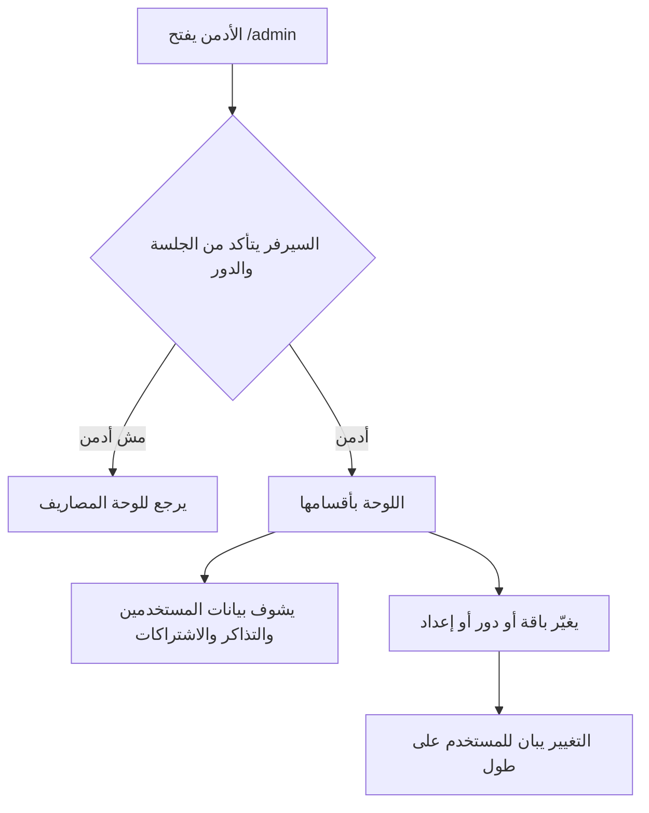

# لوحة التحكم والدعم وأدوات النمو

> الصفحة دي بتشرح من غير كود لوحة التحكم اللي بيستخدمها الأدمن، وصفحة الدعم اللي بيستخدمها المستخدم،
> والإعلانات، وبيانات محركات البحث. الشرح الهندسي بالتفصيل في [الصفحة الإنجليزي](../../systems/admin.md)،
> والرسومات المتولّدة من الكود في [صفحة الحقائق](../../atlas/systems/admin.md).

## النظام ده بيعمل إيه
- **لوحة التحكم**: صفحة للأدمن بس، فيها كل حاجة عن التطبيق: المستخدمين، والدعم، والاشتراكات، والذكاء الاصطناعي،
  والواتساب، والإعلانات، والإشعارات، والإعدادات.
- **الدعم**: المستخدم يفتح تذكرة من صفحة الدعم، والأدمن يرد عليها من اللوحة.
- **الإعلانات**: الأدمن يعمل حملة، والتطبيق يعرضها للمستخدمين حسب باقتهم الحقيقية اللي السيرفر عارفها، مش اللي التطبيق
  بيبعتها؛ فالمشترك ماتوصلوش إعلانات الباقة المجانية. والتطبيق مابيسجلش عن المستخدم غير مدة الزيارة، والسيرفر بيرفض أي
  حدث تاني.
- **محركات البحث**: عنوان ووصف لكل صفحة عامة.

## في صورة واحدة

## اللوحة الجديدة
لوحة الإدارة بقت موقع لوحدها على `/admin`، السيرفر بيقدمها من غير ما الموقع أو التطبيق يكونوا منشورين، ومابتستعيرش أي كود من الموقع (القرار 0050). الدخول بحساب Google أو برقم تليفون عنده صلاحية أدمن أو مشرف. أول صفحة «النهارده»: مين سجّل النهارده والأسبوع ده، والحسابات الجديدة، واللي رجعوا بعد أسبوع، وتكلفة الذكاء مقابل السقف، وتذاكر الدعم المفتوحة، ونداءات الذكاء اللي فشلت، وفحص حقيقي للقاعدة وRedis. وتحتها «محتاج تدخلك» بس باللي مستني تصرف. صفحة «الناس» بتدوّر على أي حد بالاسم أو الرقم أو الإيميل، وصفحة كل شخص فيها عملياته ونداءات الذكاء بتاعته بالتوكنز والتكلفة وأجهزته واشتراكه وتذاكره، وكل إجراء عليه زي تغيير الباقة أو المسح بيسأل الأول ويقول هيحصل إيه. قسم الذكاء فيه تلات صفحات: «نداءات الذكاء» بكل نداء ومين طلبه وليه وأنهي موديل رد وبكام توكن وكلّف كام، و«التصنيف وسببه» بكل جملة اتفهمت إزاي وليه بكلام عادي، و«الموصلات» تضيف فيها خدمة ذكاء بمفتاحها بعد ما تجربه (Claude أول واحد في القايمة، وبعده Gemini وغيرهم)، وتوقفها أو تغيّر مفتاحها أو تفحصها. وصفحة «إعداد الذكاء» فيها لكل وظيفة ولكل باقة الموديلات بالترتيب اللي السيرفر بيسألهم بيه، وتطلّع موديل وتنزّل موديل، وزرار «جرّب» بيكلم الموديل بجد ويقولك رد بإيه وفي قد إيه وكلّف كام، أو ليه ماردش بكلام عادي، وموديلات كل موصل (بتجيب قايمتها من الخدمة بمفتاح الموصل، والسعر بيتملي لوحده لو معروف)، وموديل تحويل الصوت لكلام لكل باقة، ومفاتيح السيرفر. صفحة «النمو» فيها رسومات بيانية: مين سجّل كل يوم ومين عمل حساب، ونسبة اللي سجّلوا أول عملية في أول 24 ساعة، وجدول بيوضح كل أسبوع تسجيل كام في المية منه رجع سجّل في الأسابيع اللي بعده، وبيسجلوا إزاي، ومن أنهي موبايل وأنهي إصدار. صفحة «الدعم» بتعرض اللي مستني رد من الأقدم، ومشرف الدعم يقدر يدخلها ويرد من غير ما يشوف باقي اللوحة. وصفحة «التشغيل» فيها مفاتيح إيقاف الميزات وسقف التكلفة وإصدارات الموبايل، بشريط «احفظ / تجاهل» بيظهر أول ما تغيّر حاجة، وسجل بكل اللي الأدمنز غيروه. صفحة «الفلوس» فيها تقدير الإيراد الشهري بالسعر المعلن قبل نصيب المتجر، والمشتركين النشطين من كل متجر، واللي اشتركوا واللي خلص اشتراكهم الشهر ده، وآخر الاشتراكات. وكل الصفحات بقت مبنية من جديد جوه اللوحة، ومفيش شاشة واحدة من اللوحة القديمة: اللوحة مابتستوردش أي كود من الموقع، وفيه اختبار بيقع لو ده حصل. أي خانة إعدادات بتتحفظ بنفس شريط «احفظ»، وفيه اختبار بيقع لو شاشة بتعدّل إعداد السيرفر بيرميه، أو إعداد محدش في السيرفر بيقراه. ولو صفحة وقعت، بيظهر زرار «حدّث الصفحة» بدل شاشة فاضية.

## مين يقدر يدخل
- اللوحة للي دوره «أدمن»، والمشرف بيدخل صفحة «الدعم» بس. الزائر اللي مش مسجل بيروح لصفحة الدخول، وأي مستخدم عادي بيتقاله إن الحساب ده مالوش صلاحية.
- مش بس الصفحة: السيرفر نفسه بيرفض أي طلب إداري جاي من غير أدمن، حتى لو حد عدّل التطبيق على جهازه.
- في اختبارات بتتأكد من ده: مستخدم بباقة غالية بيترفض، وأدمن اتشال دوره بيترفض في نفس اللحظة، والردود
  مابيطلعش فيها كلمات سر ولا مفاتيح دخول.
- دور «مشرف» (moderator) للدعم بس: يشوف تذاكر الناس ويرد عليها، ومايقدرش يفتح أي صفحة تانية.

## أقسام اللوحة
| الصفحة | فيها إيه |
| --- | --- |
| النهارده | مين سجّل النهارده والأسبوع ده، والحسابات الجديدة، واللي رجعوا، وتكلفة الذكاء قدام السقف، والتذاكر، والنداءات اللي فشلت، وفحص القاعدة وRedis، و«محتاج تدخلك» |
| الدعم | التذاكر من الأقدم، والرد، والأدمن بيقفل التذكرة |
| النمو | التسجيل والحسابات الجديدة كل يوم، والأسابيع ورا بعض، والموبايلات والإصدارات |
| الناس | البحث عن أي حد، وصفحته بكل حاجة عنه وكل إجراء عليه، وتنزيل قايمة الكل CSV بعد تنبيه إنها بيانات شخصية (والتنزيل بيتسجل) |
| الفلوس | الإيراد والاشتراكات |
| الباقات والحدود | جدول لكل نوع إعداد: صف لكل إعداد وعمود لكل باقة. المميزات (فهم الجمل، التحليل الشهري، الشات، البيزنس، الإيصالات، تقرير Pro، تحليل الأهداف، تقرير واتساب)، والحدود (التوكنز، الجمل في اليوم، طول الردود، الطلبات في الدقيقة، الصوت، التحليل الشهري، الأهداف، من غير نت، رسايل البنك وموبايلاتها)، والمكالمة (زرار إيقافها، ولكل باقة: متاحة، دقايق الشهر، أطول مكالمة، سقف التكلفة، «تفكير أعمق»، الموديل، وموديلات الأدوات، والمدرب، والسعة، وأرقام المكالمات من غير أي كلام اتقال) |
| نداءات الذكاء | كل نداء: مين، ليه، أنهي موديل، كام توكن، كلّف كام |
| التصنيف وسببه | الجودة قدام الفترة اللي قبلها (اتحفظت لوحدها، الغلط الساكت، المراجعة، الأسئلة، الرجوع للذكاء، الوقت)، و«جرّب جملة» بنفس طريق التطبيق ومن غير ما تتحفظ، وكل جملة اتفهمت إزاي وليه |
| الموصلات | خدمات الذكاء ومفاتيحها، وClaude أولها |
| إعداد الذكاء | لكل وظيفة ولكل باقة الموديلات بالترتيب، و«جرّب» بنداء حقيقي، وموديلات كل موصل، وتحويل الصوت لكلام، ومفاتيح السيرفر |
| القاموس والأسئلة | الكلمات اللي الناس علّموها للتطبيق ومسح كلمة، والأسئلة اللي التطبيق سألها وقفل القديمة |
| رسايل البنوك | «جرّب رسالة» بتوريك اللي المستخدم هيشوفه بالظبط، والأرقام لكل بنك، والإلغاء الجماعي، والبنوك والمحافظ والاشتراكات، والإعدادات |
| التواصل والإعلانات | إشعار دلوقتي لكل الناس أو باقة أو شخص مع شكله على الموبايل، ونصوص الإشعارات التلقائية، والمجدولة بتوقيت القاهرة، وآخر 100 اتبعتوا؛ وواتساب (متوصّل ولا لأ، الموافقات، الرسايل النهارده، مفاتيح الكود والتقرير والتسويق، القوالب ومراجعة Meta، آخر الرسايل بأرقام مستخبية، والرد في خلال 24 ساعة)؛ وحملات الكارت الممول بالمشاهدات والضغطات |
| التشغيل | إيقاف ميزات الذكاء، وسقف التكلفة اليومي، وإصدارات الموبايل وروابطه، وآخر 30 حاجة في السجل |
| سجل الأدمن | كل حاجة أدمن غيّرها، بفلتر الإجراء واليوم |

- **كارت كل مزود بيقول حالة مفتاحه**: متشفّر بأنهي سر، وبالأحمر لو مش بيتفك خالص. وزرار «تغيير المفتاح» بيحفظ مفتاح
  جديد من غير ما تمسح المزود وموديلاته. والنقطة جنب الاسم بتبقى رمادي لحد ما المزود يتجرب، وحمرا لو المفتاح مش
  بيتفك أو المزود واقع.
- **الموديلات**: من «إعداد الذكاء» بتجيب قايمة موديلات الموصل بمفتاحه المحفوظ، وتحدد كل موديل بيشتغل في إيه (التصنيف،
  الشات، التقارير، البحث بالمعنى، قراءة رسايل البنوك والمحافظ)، ولأنهي باقات، وشغال ولا لأ، وسعره لكل مليون توكن، والسعر
  بيتملي لوحده لو منشور. السعر ده هو اللي سجل التكلفة بيحسب بيه. والترتيب بيحدد مين يرد الأول.

## حاجات مهم تعرفها
دي مشاكل موجودة فعلاً في الكود النهارده (الشرح الدقيق لكل واحدة في الصفحة الإنجليزي):
1. **ناقص.** **مش كل إجراء بيتسجل في سجل الأدمن** لسه، ولو تسجيل الإجراء فشل، الإجراء نفسه بيكمّل.
2. **ناقص.** **مفيش نسخة احتياطية لقاعدة البيانات من اللوحة.**
3. **ناقص.** **مفيش شاشة بتقول المهام المجدولة اشتغلت إمتى آخر مرة ونجحت ولا لأ**؛ السيرفر مابيسجلش ده.
4. **ناقص.** **مفيش طريقة تدّي تذكرة لحد معين من الفريق.**
5. **ناقص.** **بيانات محركات البحث**: مفيش شاشة لتعديل عناوين الصفحات.
6. **ناقص.** الإعلانات بتظهر في تطبيق الموبايل بس.
7. **ناقص.** **في عمليات قديمة في السيرفر من غير شاشة**، وشاشات اللوحة الجديدة بتغطي اللي كانت بتعرضه. وإرسال قالب واتساب
   لمجموعة مالوش شاشة بقصد: القوالب الموجودة كلها رسايل خدمة، مش تسويق.

## لو عايز تطلب تعديل
قول للـagent يقرا `docs/systems/admin.md` الأول. أمثلة لطلبات واضحة:
- «عايز سجل بكل حاجة الأدمن بيعملها»: ده جدول جديد وتسجيل مع كل عملية مهمة.
- «خلّي إلغاء الجلسة يقفلها فوراً»: ده إصلاح المشكلة الأولى.
- «ابعت إشعار للمستخدم لما الدعم يرد عليه»: ده ربط بين الدعم والإشعارات.
- «وصّل شاشة أرقام التصنيف في قسم الذكاء الاصطناعي»: ده إصلاح المشكلة الخامسة.

## كلمات بتتكرر
| الكلمة | معناها |
| --- | --- |
| الأدمن | صاحب صلاحية لوحة التحكم |
| الدور والباقة | الدور صلاحية (مستخدم/مشرف/أدمن)، والباقة اشتراك (مجاني/Pro/Ultra) |
| التذكرة | طلب دعم من مستخدم |
| الجلسة | دخول شغال لمستخدم على جهاز |
| المزود | شركة ذكاء اصطناعي بيستخدمها التطبيق، ومعاها مفتاح سري |
| القاعدة المتعلمة | كلمة المستخدم علّمها للتصنيف |
| SEO | البيانات اللي بتساعد محركات البحث تفهم صفحات الموقع |

## حدود سعة المكالمة
الأدمن يقدر يحدد حد التوكنز في الدقيقة وحجز كل مكالمة لكل موديل. العدد الفعلي يحافظ على هامش 20% ويستخدم الأقل بين الحساب ده وسقف المكالمات. الإعدادات المحافظة لحد 65 ألف تسمح بمكالمة عادية واحدة؛ التفكير الأعمق يفضل مقفول لحد ما ينجح في التأهيل ويكون حجزه مناسبًا. تكلفة مكالمة بدلت المود تتوزع على الموديلات اللي اشتغلت فعلًا.

## سجل الأدمن
كتير من تصرفات الأدمن بقت بتتسجل في سجل مراجعة، وتظهر في تبويب المراجعة. لسه مش كل الإجراءات بتتسجل.

في إعدادات الأدمن قسم «مفاتيح التشغيل»: توقيف ميزة ذكاء عن كل الناس، وسقف التكلفة اليومي، وأقل إصدار مسموح للموبايل.

التحليلات المالية والتصدير بيستخدموا المعنى المالي المشترك: التحويلات الداخلية والاستثمار ما يدخلش في دخل الشهر أو صرفه.
