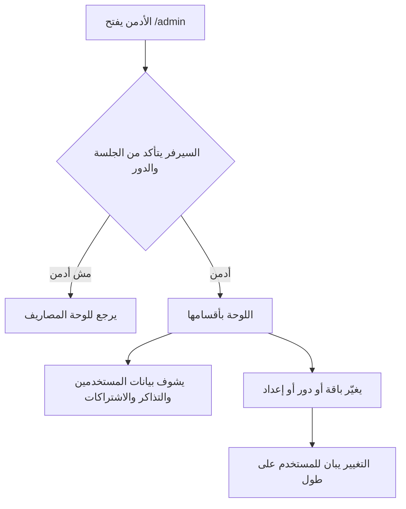

# لوحة التحكم والدعم وأدوات النمو

> الصفحة دي بتشرح من غير كود لوحة التحكم اللي بيستخدمها الأدمن، وصفحة الدعم اللي بيستخدمها المستخدم،
> والإعلانات، وبيانات محركات البحث. الشرح الهندسي بالتفصيل في [الصفحة الإنجليزي](../../systems/admin.md)،
> والرسومات المتولّدة من الكود في [صفحة الحقائق](../../atlas/systems/admin.md).

## النظام ده بيعمل إيه
- **لوحة التحكم**: صفحة للأدمن بس، فيها كل حاجة عن التطبيق: المستخدمين، والدعم، والاشتراكات، والذكاء الاصطناعي،
  والواتساب، والإعلانات، والإشعارات، والإعدادات.
- **الدعم**: المستخدم يفتح تذكرة من صفحة الدعم، والأدمن يرد عليها من اللوحة.
- **الإعلانات**: الأدمن يعمل حملة، والتطبيق يعرضها للمستخدمين حسب باقتهم الحقيقية اللي السيرفر عارفها، مش اللي التطبيق
  بيبعتها؛ فالمشترك ماتوصلوش إعلانات الباقة المجانية. والتطبيق مابيسجلش عن المستخدم غير مدة الزيارة، والسيرفر بيرفض أي
  حدث تاني.
- **محركات البحث**: عنوان ووصف لكل صفحة عامة.

## في صورة واحدة

## اللوحة الجديدة
لوحة الإدارة بقت موقع لوحدها على `/admin`، السيرفر بيقدمها من غير ما الموقع أو التطبيق يكونوا منشورين، ومابتستعيرش أي كود من الموقع (القرار 0050). الدخول بحساب Google أو برقم تليفون عنده صلاحية أدمن أو مشرف. أول صفحة «النهارده»: مين سجّل النهارده والأسبوع ده، والحسابات الجديدة، واللي رجعوا بعد أسبوع، وتكلفة الذكاء مقابل السقف، وتذاكر الدعم المفتوحة، ونداءات الذكاء اللي فشلت، وفحص حقيقي للقاعدة وRedis. وتحتها «محتاج تدخلك» بس باللي مستني تصرف. صفحة «الناس» بتدوّر على أي حد بالاسم أو الرقم أو الإيميل، وصفحة كل شخص فيها عملياته ونداءات الذكاء بتاعته بالتوكنز والتكلفة وأجهزته واشتراكه وتذاكره، وكل إجراء عليه زي تغيير الباقة أو المسح بيسأل الأول ويقول هيحصل إيه. قسم الذكاء فيه تلات صفحات: «نداءات الذكاء» بكل نداء ومين طلبه وليه وأنهي موديل رد وبكام توكن وكلّف كام، و«التصنيف وسببه» بكل جملة اتفهمت إزاي وليه بكلام عادي، و«الموصلات» تضيف فيها خدمة ذكاء بمفتاحها بعد ما تجربه، وتوقفها أو تغيّر مفتاحها أو تفحصها. صفحة «النمو» فيها رسومات بيانية: مين سجّل كل يوم ومين عمل حساب، ونسبة اللي سجّلوا أول عملية في أول 24 ساعة، وجدول بيوضح كل أسبوع تسجيل كام في المية منه رجع سجّل في الأسابيع اللي بعده، وبيسجلوا إزاي، ومن أنهي موبايل وأنهي إصدار. صفحة «الدعم» بتعرض اللي مستني رد من الأقدم، ومشرف الدعم يقدر يدخلها ويرد من غير ما يشوف باقي اللوحة. وصفحة «التشغيل» فيها مفاتيح إيقاف الميزات وسقف التكلفة وإصدارات الموبايل، بشريط «احفظ / تجاهل» بيظهر أول ما تغيّر حاجة، وسجل بكل اللي الأدمنز غيروه. صفحة «الفلوس والباقات» فيها تقدير الإيراد الشهري بالسعر المعلن قبل نصيب المتجر، والمشتركين النشطين من كل متجر، واللي اشتركوا واللي خلص اشتراكهم الشهر ده، وآخر الاشتراكات، وحدود كل باقة. واتنقلت كمان صفحات «إعداد الذكاء» (أنهي موديل لكل وظيفة، ومفاتيح السيرفر القديمة)، و«القاموس والأسئلة»، و«رسايل البنوك»، و«التواصل والإعلانات» (الإشعارات وواتساب والإعلانات). أي خانة إعدادات بتتحفظ بنفس شريط «احفظ»، وفيه اختبار بيقع لو شاشة بتعدّل إعداد السيرفر بيرميه، أو إعداد محدش في السيرفر بيقراه. ولو صفحة وقعت، بيظهر زرار «حدّث الصفحة» بدل شاشة فاضية. اللوحة القديمة لسه موجودة تحت «باقي الأدوات» للحاجات اللي لسه ما اتنقلتش.

## مين يقدر يدخل
- اللوحة للي دوره «أدمن»، والمشرف بيدخل صفحة «الدعم» بس. الزائر اللي مش مسجل بيروح لصفحة الدخول، وأي مستخدم عادي بيتقاله إن الحساب ده مالوش صلاحية.
- مش بس الصفحة: السيرفر نفسه بيرفض أي طلب إداري جاي من غير أدمن، حتى لو حد عدّل التطبيق على جهازه.
- في اختبارات بتتأكد من ده: مستخدم بباقة غالية بيترفض، وأدمن اتشال دوره بيترفض في نفس اللحظة، والردود
  مابيطلعش فيها كلمات سر ولا مفاتيح دخول.
- دور «مشرف» (moderator) للدعم بس: يشوف تذاكر الناس ويرد عليها، ومايقدرش يفتح أي صفحة تانية.

## أقسام اللوحة
| القسم | فيه إيه |
| --- | --- |
| نظرة عامة | عدد المستخدمين والمشتركين والجلسات والتذاكر المفتوحة، وحجم الفلوس وتدفقات اليوم، والمستخدمين النشطين يومياً (من نص الليل بتوقيت القاهرة) وأسبوعياً، وعدد الاشتراكات المدفوعة كلها (Pro وUltra) |
| المستخدمون | بحث وفلترة، تغيير الدور أو الباقة، عرض الملف الذكي والجلسات وإلغاء جلسة، مسح حساب، تصدير الكل، وإرسال رسالة لمستخدم |
| الدعم | التذاكر والرد عليها وقفلها |
| الذكاء الاصطناعي | أخطاء المفاتيح، وجودة التصنيف في آخر 7 أو 30 أو 90 يوم جنب الفترة اللي قبلها (كام اتحفظ لوحده، و«الغلط الساكت» يعني كام من اللي اتحفظ لوحده المستخدم رجع غيّره، والمراجعة والأسئلة والـ AI والوقت)، وتكلفة الاستهلاك في الشهر الحالي، والمزودين وموديلاتهم وأسعارهم، واستهلاك مستخدم معين مقارنةً بالحد الحقيقي بتاعه، ومعمل تجربة التصنيف |
| الاشتراكات | آخر الاشتراكات وحالتها |
| التوضيحات المعلقة | الجمل اللي التصنيف ماعرفش يحسمها |
| واتساب | ربط الرقم والرسايل |
| الحملات الإعلانية | الحملات والاستهداف والنتايج |
| القاموس والقواعد | الكلمات اللي المستخدمين علموها للتصنيف |
| رسايل البنوك | البنوك والمحافظ والتطبيقات اللي بنقرا إشعاراتها، والاشتراكات اللي بنعرفها من خصم الكارت (بتتعدّل من غير كود)، و«الأرقام»: حصل إيه في العمليات لكل بنك ونوع، والبنوك اللي وقفت عن التسجيل لوحدها، وطابور الذكاء الاصطناعي، والإلغاء الجماعي لعمليات بنك في فترة، وتتبّع مستخدم للدعم (موبايلاته وحالتها وآخر عملياته من غير نص). والأدمن بيجيله تنبيه في التطبيق لما بنك يقف أو قراية الذكاء الاصطناعي تتأخر |
| تجربة رسايل البنك | تكتب رسالة بنك أو تختار مثال، وتتبعت على نفس طريق رسالة الموبايل وتتسجل في دفترك إنت، والصفحة بتوريك كل خطوة: اتقبلت ولا لأ، النص بعد ما الأرقام اتخبّت، الذكاء الاصطناعي فهم إيه، والسطر اللي اتكتب في الدفتر |
| سجل الرقابة | آخر الجلسات، ومنه تقدر تلغي جلسة |
| الإشعارات | القوالب وسجل الإرسال وتشغيل الفحص اليومي فوراً |
| الحدود والإعدادات | تبويب لكل باقة (المجانية وPro وUltra) فيه كل حدودها ومفاتيح تشغيل مميزاتها وحدود الشات والمكالمة لكل باقة، وقسم المكالمة (زرار إيقافها، وموديلاتها، وسقف تكلفتها، و«سمارت المدرب»: نسبة طرحه وحسابات التجربة، و«تفكير أعمق»: موديله ومستواه والباقات اللي يظهر فيها، والسعة: كام مكالمة في نفس الوقت لكل موديل ولكل مستخدم، ولوحة بأرقام المكالمات مقسومة حسب الموديل والمدرب ومستوى التفكير، من غير أي كلام اتقال)، وقسم «قراءة رسايل البنوك بالذكاء الاصطناعي» (زرار إيقاف الموديل، وسقف تكلفته في اليوم بالدولار)، وقسم «تسجيل العمليات من رسايل البنك على الموبايل» (شغال طول ما الأدمن ماقفلوش، ومستخدمين التجربة، والأنظمة، والرسايل في اليوم لكل مستخدم، والبنوك الموقفة عن التسجيل لوحدها ورسايلها بتستنى المستخدم، وإشعارات الأسئلة في اليوم)، ومفاتيح الخدمات مع اختبارها |

## ليه كده؟
- **المفاتيح السرية مابتظهرش**: بتتعرض بآخر 4 حروف بس، ولو حفظت أي إعداد تاني المفتاح مابيتمسحش.
- **تغيير الدور أو الباقة أو إلغاء الجلسة بيبان فوراً**: كل العمليات دي بتعدي من مكان واحد في الكود بيمسح
  النسخة المحفوظة من الجلسة في نفس اللحظة، فمفيش «ربع ساعة» حد يفضل فيها داخل بعد ما تطرده.
- **ردود اللوحة مافيهاش كلمات سر ولا مفاتيح دخول**: السيرفر بيختار البيانات اللي تطلع بالظبط.
- **اختبار المفتاح بيبقى بأرخص طريقة**: السيرفر بيسأل المزود عن قايمة موديلاته، فيتأكد إن المفتاح شغال ويجيب
  الموديلات المتاحة في نفس الوقت.
- **كارت كل مزود بيقول حالة مفتاحه**: متشفّر بأنهي سر، وبالأحمر لو مش بيتفك خالص. وزرار «تغيير المفتاح» بيحفظ مفتاح
  جديد من غير ما تمسح المزود وموديلاته. والنقطة جنب الاسم بتبقى رمادي لحد ما المزود يتجرب، وحمرا لو المفتاح مش
  بيتفك أو المزود واقع.
- **الموديلات**: لما تفحص مزود بتظهر كل موديلاته وتقدر تدوّر فيها، وبيتحفظ بس اللي تعلّم عليه. ولكل موديل زرار «تعديل»
  تحدد منه بيستخدم في إيه (التصنيف، الشات، التقارير، البحث بالمعنى، قراءة رسايل البنوك والمحافظ)، ولأنهي باقات، وهل هو الافتراضي، وشغال ولا لأ،
  وسعره لكل مليون توكن، وفيه زرار يحط سعر المزود المنشور لو معروف. السعر ده هو اللي سجل التكلفة بيحسب بيه.

## حاجات مهم تعرفها
دي مشاكل موجودة فعلاً في الكود النهارده (الشرح الدقيق لكل واحدة في الصفحة الإنجليزي):
1. **ناقص.** **مفيش سجل بأفعال الأدمن**: مين غيّر دور أو باقة أو إعداد أو مسح حساب مش متسجل في أي مكان، و«سجل الرقابة»
   مجرد قايمة جلسات.
2. **دين تقني.** **قسم الذكاء الاصطناعي بيطلب بيانات ومابيعرضهاش**: سجل التصنيف والصوت والتكلفة التفصيلية بتتحمّل وماحدش
   بيشوفها. (جودة التصنيف نفسها بقت ظاهرة في كارت «جودة التصنيف».)
3. **ناقص.** **زرار «النسخة الاحتياطية»** بينزل الإعدادات وشوية بيانات بس، مش نسخة من قاعدة البيانات.
4. **ناقص.** **لما الأدمن يرد على تذكرة** المستخدم مابيوصلوش إشعار، مع إن صفحة الدعم بتوعد برد خلال يوم.
5. **ناقص.** **بيانات محركات البحث**: خريطة الموقع مش متاحة لأي محرك بحث أصلاً، ومفيش شاشة لتعديل عناوين الصفحات.
6. **ناقص.** الإعلانات بتظهر في تطبيق الموبايل وبتسجل المشاهدات والنقرات؛ الموقع مابيظهرش إعلانات.
7. **ناقص.** **في عمليات موجودة في السيرفر من غير شاشة**، زي إرسال إشعار يدوي، أو تحديد حد استهلاك لمستخدم معين، أو
   تعيين تذكرة لمشرف.

## لو عايز تطلب تعديل
قول للـagent يقرا `docs/systems/admin.md` الأول. أمثلة لطلبات واضحة:
- «عايز سجل بكل حاجة الأدمن بيعملها»: ده جدول جديد وتسجيل مع كل عملية مهمة.
- «خلّي إلغاء الجلسة يقفلها فوراً»: ده إصلاح المشكلة الأولى.
- «ابعت إشعار للمستخدم لما الدعم يرد عليه»: ده ربط بين الدعم والإشعارات.
- «وصّل شاشة أرقام التصنيف في قسم الذكاء الاصطناعي»: ده إصلاح المشكلة الخامسة.

## كلمات بتتكرر
| الكلمة | معناها |
| --- | --- |
| الأدمن | صاحب صلاحية لوحة التحكم |
| الدور والباقة | الدور صلاحية (مستخدم/مشرف/أدمن)، والباقة اشتراك (مجاني/Pro/Ultra) |
| التذكرة | طلب دعم من مستخدم |
| الجلسة | دخول شغال لمستخدم على جهاز |
| المزود | شركة ذكاء اصطناعي بيستخدمها التطبيق، ومعاها مفتاح سري |
| القاعدة المتعلمة | كلمة المستخدم علّمها للتصنيف |
| SEO | البيانات اللي بتساعد محركات البحث تفهم صفحات الموقع |

## حدود سعة المكالمة
الأدمن يقدر يحدد حد التوكنز في الدقيقة وحجز كل مكالمة لكل موديل. العدد الفعلي يحافظ على هامش 20% ويستخدم الأقل بين الحساب ده وسقف المكالمات. الإعدادات المحافظة لحد 65 ألف تسمح بمكالمة عادية واحدة؛ التفكير الأعمق يفضل مقفول لحد ما ينجح في التأهيل ويكون حجزه مناسبًا. تكلفة مكالمة بدلت المود تتوزع على الموديلات اللي اشتغلت فعلًا.

## سجل الأدمن
كتير من تصرفات الأدمن بقت بتتسجل في سجل مراجعة، وتظهر في تبويب المراجعة. لسه مش كل الإجراءات بتتسجل.

في إعدادات الأدمن قسم «مفاتيح التشغيل»: توقيف ميزة ذكاء عن كل الناس، وسقف التكلفة اليومي، وأقل إصدار مسموح للموبايل.

التحليلات المالية والتصدير بيستخدموا المعنى المالي المشترك: التحويلات الداخلية والاستثمار ما يدخلش في دخل الشهر أو صرفه.
