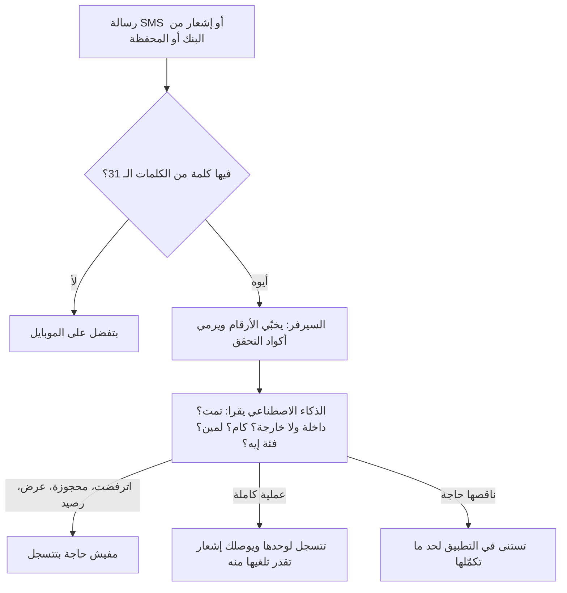

# رسائل البنوك والمحافظ

> الصفحة دي بتشرح من غير كود نظام تسجيل رسايل البنك والمحفظة لوحدها.
> الشرح الهندسي بالتفصيل في [الصفحة الإنجليزي](../../systems/bank-messages.md)، والرسومات المتولّدة من الكود في
> [صفحة الحقائق](../../atlas/systems/bank-messages.md).

## النظام ده بيعمل إيه
إنت بتدفع بأي طريقة: كارت، Apple Pay، InstaPay، فودافون كاش، تحويل بنكي. البنك أو المحفظة بيبعتلك رسالة أو إشعار.
التطبيق بيبعت الرسالة دي للسيرفر، والذكاء الاصطناعي بيفهمها، وتلاقيها في دفترك صرف أو دخل بتفاصيلها، من غير ما
تكتب حاجة. ده شغال مع أي بنك، حتى لو عمرنا ما شفنا رسايله قبل كده (القرار 0049).

## الرحلة في صورة واحدة

## خطوة بخطوة
1. **الموبايل:** بيبعت أي رسالة أو إشعار من تطبيقات البنوك والمحافظ، أو أي SMS في نسخة SMS، لو فيها كلمة من
   الكلمات الـ 31 اللي اخترتها (زي خصم، تحويل، رصيد، purchase، payment). أي حاجة تانية مابتخرجش من موبايلك.
2. **السيرفر:** بيتأكد إن الرسالة مش من رقم موبايل شخص، وإن فيها الكلمة، وإنها مش من كارت إنت قلت نتجاهله. كود التحقق
   بيترمي على طول ومابيتحفظش ومابيروحش للذكاء الاصطناعي.
3. **الخصوصية:** أرقام الموبايلات والكروت والحسابات والمراجع والأكواد بتتخبّى قبل أي حاجة. أسماء المحلات والناس بتفضل،
   عشان الذكاء الاصطناعي يعرف إن TALABAT مطعم وإن «منى» شخص. الرسالة بتتحفظ متخبّي منها الأرقام 30 يوم.
4. **القراية:** الكود بيعلّم كل رقم في الرسالة بعلامة (N1 وN2…)، والذكاء الاصطناعي بيقول أنهي علامة هي المبلغ وأنهي
   الرسوم وأنهي الرصيد. يعني المبلغ دايماً رقم مكتوب فعلاً في الرسالة، والموديل مايقدرش يألّف رقم.
5. **الفحص:** مفيش قوايم كلمات. الفحص بيتأكد إن الرد سليم، وإن المبلغ موجود ومش هو الرصيد، والاتجاه بييجي من نوع
   العملية: الشراء والسحب والفاتورة خارجين، والمرتب والمرتجع داخلين. لو الرد مش سليم، بيتسأل موديل تاني.
6. **التسجيل:** العملية الكاملة بتتسجل لوحدها. لو ممكن تكون نفس عملية قبلها، أو عملية بالدولار من غير مبلغ بالجنيه،
   بتستنى في التطبيق لحد ما تأكدها. لو الموديل واقع، الرسالة بتستنى وبتتقري أول ما يرجع، ومابتضيعش.

## إيه اللي بيتكتب في الدفتر
- كل حاجة صرف أو دخل: فلوس بعتها لأي حد صرف، وفلوس استلمتها دخل.
- فلوسك وهي بتتنقل بين جيوبك (من حسابك لمحفظتك، سحب ATM، سداد الكريدت كارد) بتتسجل باتجاهها، بس مابتدخلش في إجمالي
  الصرف والدخل.
- السطر مكتوب زي ما الواحد بيقوله: «إرسال إلى Sara Mostafa · CIB»، «استلام من منى · فودافون كاش»، «شراء · TALABAT».
  رقم الموبايل بيظهر آخر 4 أرقام بس.
- التفاصيل: الرسوم، وطريقة الدفع، والطرف التاني، وآخر أرقام الكارت، والرصيد بعدها. والرسوم بتتسجل مربوطة بالعملية.
- الفئة: لو قلتلنا قبل كده المحل ده فئته إيه، بنستخدمها. لو لأ، الذكاء الاصطناعي بيختار فئة وفئة فرعية. ولو مش
  عارف، بتبقى «متنوعات / عام».
- لو الدفعة دي قسط أو اشتراك متسجل عندك في «التزاماتي»، كل 10 دقايق السيرفر بيحاول يربطها بيه بنفس الشروط الصارمة
  بتاعة الكتابة (للباقات اللي فيها «ربط رسايل البنوك بالالتزامات»).

## الأسئلة بعد الحفظ
لو فتحت «اسألني اتصرفت في إيه» من إعدادات رسايل البنك، أي عملية اتسجلت في «عام» أو تحويل لحد، بنسألك عنها لما تفتح
التطبيق: صرفتها في إيه أو بعتها لمين. إجابتك بتتحفظ للمرة الجاية. الأسئلة مقفولة لحد ما إنت تفتحها.

## الموبايل
- نسخة SMS: بتقرا رسايل البنك أول ما توصل، وفيها زرار يسجّل رسايل آخر 30 يوم. النسخة دي مش هتنزل على Google Play
  غير لما Google توافق على إعلان SMS. النسخة العادية بتقرا إشعارات تطبيقات البنوك والمحافظ بس.
- الآيفون مفيهوش قراية رسايل SMS خالص، وطريقه لسه ماتبناش.

## الأدمن
- مفتاح تسجيل رسايل البنك شغال طول ما الأدمن ماقفلوش.
- لو بنك غيّر شكل رسايله والتسجيل بقى غلط، الأدمن يوقفه (أو النظام يوقفه لوحده لو المستخدمين لغوا عمليات كتير منه)،
  ورسايله ساعتها بتتقري وتستنى تأكيد المستخدم.
- سقف تكلفة يومي للذكاء الاصطناعي، ولو اتعدّى الرسايل بتستنى لبكره.
- قايمة الاشتراكات المعروفة: أشهر اللي الناس في مصر بتدفعه (أفلام ومسلسلات ورياضة، موسيقى، ذكاء اصطناعي، برامج
  وتخزين وألعاب، تعليم وكتب، سوشيال، توصيل ومواصلات). طلبات برو وكريم بلس وأوبر وان بيتعرفوا باسم الاشتراك نفسه بس،
  مش باسم التطبيق اللي بيظهر في كل أوردر.
- **اللوجو الحقيقي**: السيرفر بيجيب لوجو كل خدمة من صفحة تطبيقها الرسمية على جوجل بلاي، أو من تطبيقها الرسمي على
  Microsoft Store (زي iCloud)، أو من موقعها، وبيختار الصورة الواضحة (128 بكسل أو أكتر). بيحفظه عنده ويبعته للتطبيق،
  والتطبيق بيحفظه على الموبايل أول مرة ومابيحمّلوش تاني. ده بيحصل أول ما السيرفر يشتغل وكل يوم، ولو الملفات ضاعت بعد
  تحديث السيرفر بترجع لوحدها. كل الخدمات الشغالة (48) ليها لوجو حقيقي واضح. الأدمن يقدر يحط رابط لوجو بإيده وده
  بيكسب. وبيتقبل بس صور عادية (مش SVG) من مواقع عامة.
- أول ما السيرفر يشتغل، بيحوّل الدفتر لنظام الدخل والصرف لوحده. ولو لقى عمليات قديمة مش واضحة، بيبلّغ الأدمن ويستنى.

## تجربة من غير موبايل
في لوحة الإدارة، صفحة «رسايل البنوك»، تبويب «جرّب رسالة»: تلصق نص رسالة زي ما البنك بيبعتها (أو تختار مثال)، وهي بتعدّي على نفس طريق
رسالة الموبايل بالظبط وبتتسجل في دفترك إنت. الصفحة بتوريك اللي المستخدم هيشوفه بالظبط: الإشعار على الموبايل، وبعده السطر زي ما بيظهر في قايمة العمليات في
التطبيق، أو ليه ماتسجلتش. والتفاصيل اللي ورا الشاشة (النص بعد ما الأرقام اتخبّت، والذكاء الاصطناعي فهم إيه) متطبّقة تحت.

## القياس
عملنا 60 رسالة مخترعة بأشكال بنوك ومحافظ مختلفة، **قبل** ما نكتب البرومبت، وقفلناها: ماحدش يعدّل فيها عشان تطلع
النتيجة أحسن. النتيجة (2026-11-05): gemini-3.5-flash-lite جاب 60 من 60، وqwen على Groq جاب 60 من 60،
وgemini-3.1-flash-lite جاب 57 من 60 (اتنين بسبب أخطاء من المزود، وواحدة اتصلحت بعدها). دي رسايل مخترعة؛ القياس الحقيقي
هيبقى على رسايلك الحقيقية بأمر `npm run bench:capture`، اللي مابيطبعش نص أي رسالة.

## حاجات مهم تعرفها
1. ماحدش جرّب النظام على موبايل حقيقي لسه. الجهاز اللي اتعمل عليه الشغل مايقدرش يشغّل محاكي أندرويد، فاتجرّب من
   أول ما الموبايل يبعت الرسالة للسيرفر لحد ما تظهر في الدفتر، بموديل حقيقي وقاعدة بيانات حقيقية.
2. لو نفس العملية وصلت SMS وإشعار من تطبيق البنك، بتتسجل مرة واحدة لما الاتنين يذكروا نفس الكارت أو الحساب أو المحل أو
   الرصيد. لو مفيش ولا واحدة فيهم، ممكن تتسجل مرتين.
3. أسماء الناس والمحلات اللي في رسايل البنك بتروح لمزود الذكاء الاصطناعي بموافقتك. على الإنتاج لازم حساب مدفوع
   مابيستخدمش البيانات في التدريب، ومراجعة المحامي.
4. مفيش لسه طريقة يصدّر بيها الأدمن عينات الرسايل.

## لو عايز تطلب تعديل
- عايز تغيّر الكلمات اللي الموبايل بيبعت عليها: قايمة الكلمات بتتغير من السيرفر من غير نسخة تطبيق جديدة.
- عايز موديل تاني أو مزود تاني: من شاشة مزودين الذكاء الاصطناعي، غرض «قراءة رسايل البنوك والمحافظ».
- عايز بنك جديد يظهر اسمه: من قسم رسايل البنوك في لوحة الأدمن. حتى من غيره، رسايل البنك بتتقري وتتسجل.
