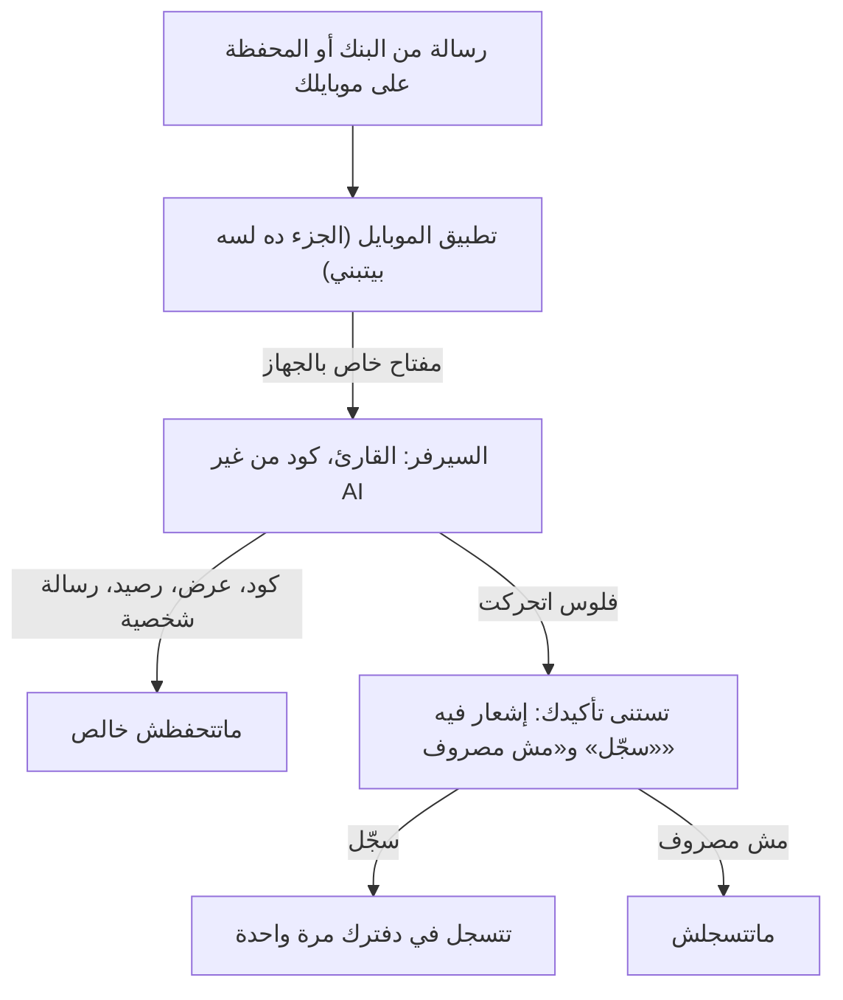

# رسائل البنوك والمحافظ

> الصفحة دي بتشرح من غير كود نظام تسجيل رسايل البنك والمحفظة لوحدها، وده بيتبني من جديد.
> الشرح الهندسي بالتفصيل في [الصفحة الإنجليزي](../../systems/bank-messages.md)، والرسومات المتولّدة من الكود في
> [صفحة الحقائق](../../atlas/systems/bank-messages.md).

## النظام ده بيعمل إيه
الهدف: بدل ما تكتب كل مرة دفعت فيها بالكارت أو حوّلت على InstaPay أو فودافون كاش، الرسالة اللي البنك أو المحفظة
بيبعتهالك تتسجل عملية لوحدها.

**النظام القديم اتشال كله:** تطبيق الأندرويد الصغير (SmartSpend Sync)، واختصار الآيفون، والطريق اللي كان بيستقبل
الرسايل على السيرفر، والقواعد القديمة، والاقتراحات اللي كانت بتستنى تأكيدك، وشاشات الربط. اللي موجود دلوقتي:
- قايمة البنوك والمحافظ والاشتراكات.
- القارئ: كود بيقرا الرسالة من غير AI.
- الموديل اللي الأدمن اختاره، للرسايل اللي القارئ مش متأكد منها (لسه محدش بينادي عليه).
- **الاستلام الجديد على السيرفر**: الموبايل بيبعت الرسالة، والسيرفر بيقراها، و**كل عملية بتستنى تأكيدك** قبل ما
  تتسجل. **بس لسه مفيش موبايل بيبعت**: الجزء اللي على أندرويد وشاشات التطبيق هما الخطوة الجاية، والأدمن لسه
  ماشغّلش الاستلام.

العمليات اللي اتسجلت من الرسايل قبل كده **بتفضل في دفترك زي ما هي**، والإحصائيات لسه بتعدّها كعمليات اتسجلت لوحدها.

## الرحلة الجاية في صورة واحدة

## مين اللي بنقرا رسايله (قايمة البنوك والمحافظ)
فيه قايمة واحدة على السيرفر بكل البنوك المرخّصة في مصر (37)، ومحافظ الموبايل (فودافون كاش، اتصالات كاش، أورنج كاش،
وي باي)، وانستاباي وفوري، وتطبيقات الفلوس والتقسيط (ڤاليو، تيلدا، حالا، خزنة…)، وتطبيقات الرسايل. ومعاها قايمة
بالاشتراكات المعروفة (نتفليكس، شاهد، سبوتيفاي، ChatGPT، Claude…) والكلمات اللي بتظهر بيها في رسالة البنك لما الكارت
يتخصم منه.
- **مفيش حاجة متخمّنة.** اسم تطبيق البنك على أندرويد بيتكتب بس لما يكون متأكد منه على Google Play تحت اسم البنك
  نفسه. واسم الراسل في الـ SMS بيتكتب بس لما رسالة حقيقية تورّيه، وعشان كده لسه فاضي.
- **الأدمن بيعدّل من غير ما نرفع كود:** في لوحة الأدمن، قسم «رسايل البنوك»، يقدر يضيف بنك أو تطبيق أو اشتراك، أو
  يوقفه، أو يعدّله. التعديل بيوصل كل السيرفرات في ثواني، والموبايلات أول ما تسأل، من غير تحديث للتطبيق. وزرار «حمّل
  البيانات الأصلية» بيحط القايمة اللي جاية مع البرنامج، من غير ما يمسح تعديلات الأدمن.

## الاستلام: الموبايل بيبعت، وإنت بتأكّد
- **مفتاح خاص بكل موبايل**: وإنت مسجّل دخول، التطبيق بياخد مفتاح للجهاز ده، وبيبعت بيه الرسايل حتى لو التطبيق مقفول
  أو الجلسة خلصت. المفتاح ده مايقدرش يعمل حاجة غير إنه يبعت رسايل البنك ويرد على إشعاراتها. لو خرجت من كل الأجهزة
  أو غيّرت الباسورد، المفتاح بيقف، ولو مسحت حسابك بيتمسح.
- **موافقتك متسجلة**: قبل ما أي رسالة تتبعت، لازم توافق، وموافقتك بتتسجل بنسخة النص اللي قريته. ولو رجعت فيها،
  الاستلام بيقف والسجل بيفضل.
- **السيرفر بيرمي اللي مش لازم**: إشعار من تطبيق مش في القايمة، أو رسالة من رقم شخص، أو كود، أو عرض، أو رصيد بس،
  مابيتحفظش منه أي حاجة. ورسالة من راسل مش معروف لازم يبقى فيها كارتك أو حسابك أو رصيدك.
- **كل عملية بتستنى تأكيدك**: بيجيلك إشعار بالمبلغ والمحل والفئة المقترحة، وفيه «سجّل» و«مش مصروف». لو المبلغ بعملة
  أجنبية أو القارئ مش متأكد منه، الإشعار بيقولك تفتح التطبيق وتأكد. ومن التطبيق تقدر تغيّر الفئة.
- **الفئة المقترحة**: الاشتراكات المعروفة في فئتها، وأي شراء تاني في «متنوعات» لحد ما تغيّره، والفواتير والشحن
  والرسوم والأقساط والمرتب في أماكنهم، والسحب من الـ ATM والتحويلات «تحويل» مش مصروف.
- **بتتسجل مرة واحدة**: حتى لو دوست مرتين أو الموبايل بعت الرسالة تاني. ونص رسالة البنك عمره ما بيدخل دفترك:
  بيفضل متخبّي الأرقام 30 يوم بس وبعدين بيتمسح.
- **الأدمن عنده زرار يقفل الاستلام كله** في أي وقت، والموبايلات بتعرف وتقف.

## القارئ
ده أول طبقة في النظام الجديد: كود بيقرا الرسالة من غير AI.
- **بيطلّع:** نوع العملية واتجاهها، والمبلغ والعملة، والرصيد أو الحد المتاح، وآخر أرقام الكارت، والطرف التاني (تاجر أو شخص أو رقم أو عنوان انستاباي)، والوقت.
- **بيقول هو متأكد قد إيه، وليه.** والكلمات اللي قرا منها بتتلوّن عشان المستخدم يشوفها.
- **مش متأكد؟** الرسالة بتروح للـ AI بعدها.
- **متقاس على أكتر من 300 رسالة مكتوبة على أشكال البنوك والمحافظ.** والاختبار بيوقع لو القارئ قال «متأكد» وكان غلطان.
- **الاستلام الجديد بيستخدمه** مع كل رسالة.

## الموديل (لسه مش متوصل)
الطبقة التانية: الموديل بيقرا الرسالة اللي القارئ مش متأكد منها، وهو محكوم من الأدمن بالكامل:
- **مين يقرا**: الأدمن بيختار المزود والموديل من شاشة مزودي الذكاء الاصطناعي، غرض «قراءة رسايل البنوك والمحافظ»:
  OpenRouter بأي موديل، أو Gemini، أو أي مزود شبهه. الرسالة مابتروحش لأي مزود تاني غير اللي اختاره. ولحد ما
  يختار، بيقرا مفتاح Gemini بتاع السيرفر (ده مؤقت).
- **إمتى ما يقراش**: لو الأدمن قفله، أو حدود الذكاء الاصطناعي في باقتك خلصت، أو التكلفة في اليوم وصلت السقف اللي
  الأدمن حطه بالدولار. ساعتها بيقول السبب.
- **إيه اللي بيخرج**: قبل ما الرسالة تروح للموديل، الكلام اللي مالوش لازمة بيتشال (التحية والخط الساخن واللينكات
  والإعلانات)، والأسماء وأرقام الكروت والحسابات والـIBAN والتليفونات وأرقام المرجع والإيميلات والأكواد بتتشال وتتحط
  مكانها علامة. المبالغ والرصيد والتاريخ واسم المحل بيفضلوا. وكل مرة رسالة واحدة لمستخدم واحد، عمرها ما بتتجمع مع
  رسايل حد تاني.
- **بنراجع إجابته**: المبلغ لازم يكون مكتوب في الرسالة، والعملة كود رسمي، والفئة من قايمة التطبيق، والاتجاه متفق مع
  نوع الرسالة. لو حاجة منهم غلط، إجابته بتترمي. والعملية المرفوضة، والمبلغ المحجوز، والكود، والعرض، عمرهم ما بيبقوا
  عمليات. والمبلغ بعملة أجنبية من غير ما الرسالة تقول قيمته بالجنيه مابيتاخدش على إنه جنيه.
- **بيتحسب**: كل قراية بتتسجل في تكلفة الذكاء الاصطناعي بسعر المزود، وبتتخصم من حدود باقتك. وسجل السيرفر مابيكتبش
  نص الرسالة ولا مبلغها.

## البيانات
- قايمة البنوك والمحافظ والاشتراكات: مشتركة بين كل المستخدمين، ومفيهاش بيانات حد.
- أجهزتك اللي بتبعت الرسايل، وموافقاتك، والرسايل اللي مستنية ردك أو اتردّ عليها (30 يوم بس).
- جدولين النظام القديم (رموز الربط والرسايل الخام، ومعاها الاقتراحات اللي كانت مستنية تأكيد) اتمسحوا من قاعدة البيانات.

## حاجات مهم تعرفها
دي مشاكل موجودة فعلاً في الكود النهارده (الشرح الدقيق لكل واحدة في الصفحة الإنجليزي):
1. **ناقص.** **لسه مفيش موبايل بيبعت**: الجزء اللي على أندرويد وشاشات الإعداد والمراجعة في التطبيق هما الخطوة الجاية.
   والموديل لسه محدش بينادي عليه، فالرسالة اللي القارئ مالقاش فيها مبلغ بتترمي.
2. **دَين.** **مفتاح Gemini بتاع السيرفر لسه هو اللي بيقرا** لحد ما الأدمن يختار موديل لغرض «قراءة رسايل البنوك
   والمحافظ». المفروض يتشال لما المفتاح يتسجل مزود في الأدمن.
3. **ناقص.** **اسم المحل بعد «من» أو from بيتشال** كأنه اسم شخص قبل ما يروح للموديل، فالموديل مابيشوفوش. اسم المحل
   بعد «لدى» أو at بيفضل.
4. **ناقص.** **العملية الواحدة ممكن تيجي في أكتر من رسالة** (SMS البنك وإشعار تطبيقه)، وكل واحدة بتتسأل عنها لوحدها
   لحد ما الدمج يتعمل.

## لو عايز تطلب تعديل
قول للـagent يقرا `docs/systems/bank-messages.md` الأول. أمثلة لطلبات واضحة:
- «رسايل بنك كذا القارئ مش بيفهمها، دي عينة منها بعد ما غطيت الأرقام»: ده تعديل في القارئ ومكتبة الأمثلة.
- «عايز رسايل البنوك يقراها موديل تاني، أو أوقف الموديل، أو أحط سقف يومي»: ده من الأدمن من غير كود (شاشة المزودين،
  وقسم «قراءة رسايل البنوك بالذكاء الاصطناعي» في الإعدادات).
- «ضيف بنك أو اشتراك للقايمة»: ده من الأدمن من غير كود، قسم «رسايل البنوك».

## كلمات بتتكرر
| الكلمة | معناها |
| --- | --- |
| القارئ | كود بيقرا الرسالة ببلاش ومن غير AI، وبيقول هو متأكد قد إيه |
| الموديل | خدمة ذكاء اصطناعي خارجية بتقرا الرسايل اللي القارئ مش متأكد منها، والأدمن هو اللي بيختارها |
| التنضيف | شيل الأسماء وأرقام الكروت والحسابات والتليفونات والمراجع من الرسالة قبل ما تروح للموديل |
| السقف اليومي | أقصى تكلفة بالدولار لقراية الرسايل بالموديل في اليوم لكل المستخدمين مع بعض، والأدمن بيحدده |
| قايمة البنوك والمحافظ (capture catalog) | الجهات اللي بنقرا إشعاراتها والاشتراكات اللي بنعرفها، والأدمن بيعدّلها |
