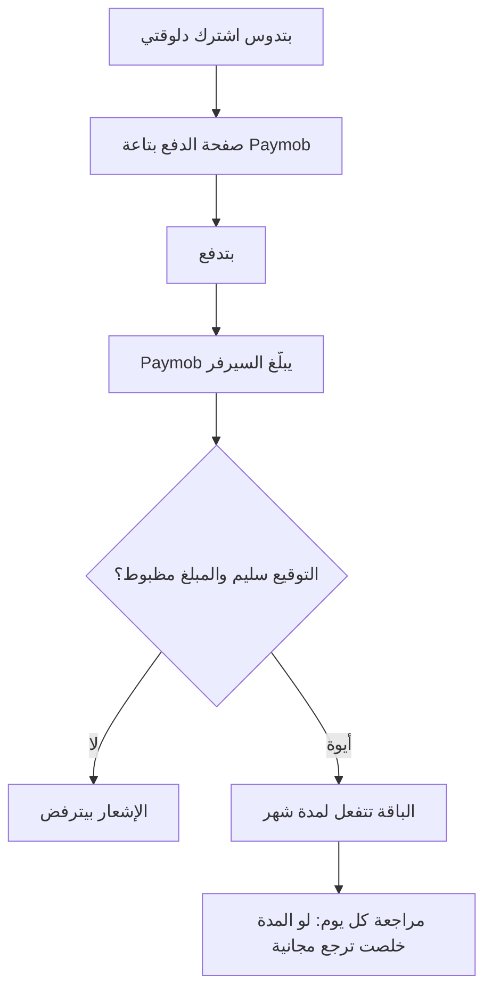

# الباقات والدفع

> الصفحة دي بتشرح من غير كود الباقات (المجانية وPro وUltra)، وإزاي بتدفع وتتفعل الباقة، وإزاي بتنتهي.
> الشرح الهندسي بالتفصيل في [الصفحة الإنجليزي](../../systems/billing.md)، والرسومات المتولّدة من الكود في
> [صفحة الحقائق](../../atlas/systems/billing.md).

## النظام ده بيعمل إيه
- **الباقات**: المجانية، وPro بـ99 جنيه في الشهر، وUltra بـ250 جنيه في الشهر (زي ما مكتوب في صفحة الخطط).
- **الدفع**: بتدوس «اشترك دلوقتي» فيوديك لصفحة الدفع بتاعة Paymob، وبعد ما تدفع الباقة بتتفعل لوحدها.
- **المدة**: الاشتراك الشهري بيكمل شهر، ولو جددت قبل ما يخلص المدة بتتزود على اللي فاضل ومبتضيعش.
- **النهاية**: كل يوم الصبح التطبيق بيراجع الاشتراكات اللي خلصت ويرجّع أصحابها للباقة المجانية.
- **أكواد الخصم والدعوة**: اتشالت من الشاشات والسيرفر لحد ما يبقى فيه عرض حقيقي من المتاجر.
- **كل باقة فيها إيه**: الأدمن هو اللي بيحدده من لوحة التحكم، مش الكود. فيه تبويب لكل باقة (المجانية وPro وUltra) فيه
  الحدود (التسجيلات في اليوم، ورصيد الذكاء الاصطناعي، والصوت، والأهداف، والشات، وعمليات رسايل البنك في الشهر...) ومفاتيح تشغيل المميزات
  (وضع البيزنس، والإيصالات، وتقرير Pro للطباعة، وتحليل الأهداف، وتقرير الواتساب). القيم المبدئية هي نفس اللي كانت مكتوبة
  في الكود قبل كده. وصفحة الخطط بتعرض نفس الأرقام دي، فمش ممكن توعد بحاجة غير اللي السيرفر بيطبقه.

## الشراء من المتاجر
Pro ممكن يتباع من جوجل بلاي وآب ستور. السيرفر عمره ما بيصدق كلام الموبايل أو الطلب اللي جاي: بيتأكد من توقيع جوجل وأبل، وبيقرا حالة الاشتراك من جوجل نفسها.
كل عملية شراء ليها صف واحد، وكل حدث بيتسجل مرة واحدة، فالتكرار أو طلبين في نفس اللحظة ما يدّوش الاشتراك مرتين. والشراء بيتربط بالحساب اللي اشتراه، ولا يمكن حساب تاني ياخده.
الشراء من المتاجر مش شغال لحد ما حسابات المتاجر تتظبط.

## في صورة واحدة

## ليه كده؟
- **السيرفر مابيصدقش الموبايل**: الباقة مابتتفعلش إلا لما Paymob نفسه يبلّغ بإشعار موقّع بسر مايعرفوش غير السيرفر.
  ولو السر ده مش متظبط، السيرفر بيرفض كل الإشعارات، في أي بيئة.
- **المبلغ لازم يكون مظبوط**: لو المبلغ المدفوع مختلف عن سعر الباقة، الإشعار بيترفض.
- **الدفعة الواحدة ماتتحسبش مرتين**: لو نفس الإشعار وصل تاني، مابيزودش مدة.
- **الباقة بتبان على طول**: بعد التفعيل، الجلسة بتتحدث فتشوف مميزات الباقة من غير ما تسجل خروج.
- **بيانات الكارت مابتتكتبش في سجل السيرفر**: من إشعار Paymob بيتكتب رقم العملية، ونجحت ولا لأ، والمبلغ بس.

## أكواد الخصم والدعوة
الأكواد مش متاحة حاليًا، حسب [القرار 0042](../../decisions/0042-no-codes-until-store-offers.md). مفيش حقل كود في التسجيل، ولا صفحة دعوات، ولا إدارة أكواد في لوحة الأدمن. الجداول القديمة وأكواد الحسابات بتفضل محفوظة، من غير ترحيل أو حذف بيانات. لو نسخة قديمة بعتت كود مع التسجيل، السيرفر بيتجاهله.

## حاجات مهم تعرفها
دي مشاكل موجودة فعلاً في الكود النهارده (الشرح الدقيق لكل واحدة في الصفحة الإنجليزي):
1. **ناقص.** **مفيش طريقة تشتري Ultra**: زرار الترقية بيوديك لصفحة فيها «هنضيف مميزات قريباً»، واللي مش على Ultra بيرجع لصفحة الباقات. والاشتراك
   السنوي مالوش زرار.
2. **ناقص.** **مفيش تجديد تلقائي**: التطبيق بيفكّرك قبل ما الاشتراك يخلص بـ3 أيام وتاني آخر يوم، وفي آخر أسبوع
   صفحة الخطط بتوريك زرار «جدّد بضغطة» لنفس باقتك، والمدة الجديدة بتبدأ من آخر المدة الحالية. الخصم التلقائي من الكارت
   محتاج خدمة الدفع المتكرر من Paymob. و«إلغاء البرو»
   بيغير الحالة المكتوبة بس، ومفيش استرجاع فلوس من التطبيق.
   واشتراك المتجر بيتجدد من المتجر نفسه مهما اتكتب عندنا، فتطبيق الموبايل بيفتح صفحة اشتراكاتك في
   Google Play أو App Store عشان تلغيه من هناك.
3. **دين تقني.** **مفيش اختبارات** بتتأكد إن تفعيل الباقة نفسه في قاعدة البيانات، ومراجعة انتهاء الاشتراكات
   شغالين صح. التحقق من توقيع إشعار الدفع عليه اختبار.

## لو عايز تطلب تعديل
قول للـagent يقرا `docs/systems/billing.md` الأول. أمثلة لطلبات واضحة:
- «عايز الناس تقدر تشتري Ultra»: محتاج زرار دفع لـUltra، وحماية صفحة Ultra، ومميزات حقيقية ليها.
- «رجّع عروض الدعوة»: محتاج عرض فعلي في المتجر والتحقق منه على السيرفر.
- «غيّر سعر Pro»: السعر في مكان واحد، وصفحة الخطط لازم تتعدل معاه.

## كلمات بتتكرر
| الكلمة | معناها |
| --- | --- |
| Paymob | شركة الدفع الإلكتروني اللي بتستقبل فلوس الاشتراك |
| الإشعار (webhook) | رسالة Paymob بتبعتها للسيرفر بعد الدفع |
| التوقيع (HMAC) | ختم رقمي بيثبت إن الإشعار جاي من Paymob فعلاً |
| الاشتراك | فترة الباقة المدفوعة من تاريخ البداية لتاريخ النهاية |
| عروض المتاجر | عروض خصم معتمدة من Google Play أو App Store؛ لازم تنفيذها قبل رجوع الأكواد |
