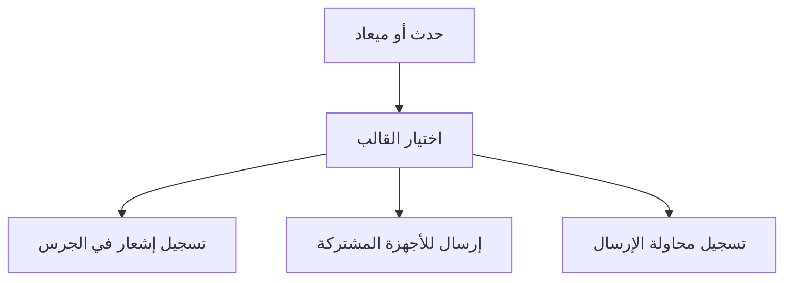

# الإشعارات والواتساب

> الصفحة دي بتشرح طريقة وصول الإشعارات والرسائل للمستخدم. التفاصيل الهندسية في
> [الصفحة الإنجليزي](../../systems/notifications.md)، والحقائق المتولدة من الكود في
> [صفحة الحقائق](../../atlas/systems/notifications.md).

## النظام بيعمل إيه
- الإشعارات ممكن توصل للمتصفح أو لتطبيق Flutter بعد إعداد الخدمة وموافقة المستخدم. إشعارات Flutter تستخدم Firebase؛
  وجود الكود وحده لا يثبت وصولها على جهاز فعلي.
- إشعارات القوالب بتتحفظ في جرس التطبيق وبتتبعت للأجهزة المشتركة؛ بعض رسائل الأدمن المباشرة إشعار خارجي فقط.
- الأدمن يقدر يجهز إشعارات مجدولة، وفيه تنبيهات ميزانية وتذكيرات تسجيل واقتراب انتهاء الاشتراك.
- واتساب يستخدم واجهة Meta الرسمية، ويرسل أكواد التحقق والتقارير والرسائل المسموح بها بعد ضبط الإعدادات والموافقات.

## في صورة واحدة

## الإشعارات التلقائية
| الإشعار | إمتى ولمين |
| --- | --- |
| اقتراب الميزانية أو تجاوزها | بعد تسجيل مصروف، حسب حد التنبيه لكل ميزانية؛ الافتراضي 80% ويمكن تغييره. |
| الاشتراك قرب يخلص | يوميًا للمشترك قبل النهاية بثلاثة أيام وفي آخر يوم، ما لم يكن جدد. |
| المصاريف تعدي الدخل | لو مفيش ميزانيات ومصاريف الشهر عدت الدخل المسجل، مرة في الشهر. |
| تذكير التسجيل | للمستخدم الذي مضى على آخر تسجيل له من 12 إلى 36 ساعة، حسب شروط القالب. |
| دعوة Pro والرجوع بعد غياب | وفق شروط النشاط وقوالب الأدمن، بحد أسبوعي. |

## واتساب
- أكواد التحقق تُرسل من Meta إلى الشخص، وهو يكتب الكود في التطبيق. إرسال التقرير والرسائل الجماعية يخضع للموافقات
  وإعدادات الخدمة. لا يوجد إرسال بالطريقة القديمة لو مفاتيح Cloud API ناقصة.
- الرسائل المؤجلة تسجل في طابور يحاول مجددًا عند بعض الأخطاء المؤقتة. رسالة الأدمن النصية المباشرة تُرسل أولًا ثم
  تُسجّل؛ ليست ضمن إعادة المحاولة بالطابور. استقبال أحداث Meta يحتاج تحقق التوقيع.
- الكود لا يكتب نص الرسالة أو كود التحقق في سجل الواتساب؛ وطلبات الإرسال الجماعي تتطلب الموافقة المناسبة.

## حاجات مهمة
1. **دين تقني.** اختبارات الواتساب تغطي العميل والاستقبال والطابور؛ فحوص النشاط والقوالب المجدولة لا يغطيها اختبار
   بقاعدة بيانات حقيقية، واختبار payload الإشعارات يغطي شكل الرسالة.
2. **ناقص.** تذكير التسجيل لا يصل لمن أنشأ حسابًا ولم يسجل أي مصروف.
3. **ناقص.** قالب عدّله الأدمن يحتفظ بنصه، وقد يظل فيه الوعد القديم بخصم 30% الذي لا يطبقه الدفع.
4. **ناقص.** لا توجد طريقة من الويب لإزالة جهاز من اشتراكات الإشعارات، ولا توجد سياسة دورية لحذف إشعارات الجرس.
   سجل الإرسال يخضع للحذف بعد 90 يومًا عند تشغيل مهمة الاحتفاظ. أغلفة Capacitor ليس لها إشعارات أصلية خاصة بها.

لتغيير السلوك، اطلب من الـagent قراءة [الشرح الإنجليزي](../../systems/notifications.md) والكود المرتبط أولًا.
