<!-- GENERATED by `npm run atlas` from the source code and docs/architecture/systems.json. Do not edit: the next run overwrites this file. -->

# Admin console, support and growth tools

The standalone admin console at /admin/ (users and manual plan grants, dynamic plan features and limits, store billing controls, settings, AI providers, notification templates, learned rules), support tickets, ads, SEO pages and usage analytics.

How it works: [docs/systems/admin.md](../../systems/admin.md) · بالعربي: [docs/ar/systems/admin.md](../../ar/systems/admin.md) · [All systems](README.md)

## What it is made of

Solid arrows: calls and uses. Thick arrows: writes a table. Dotted arrows: reads a table. A double-bordered box is another system this one depends on.

```mermaid
flowchart LR
  subgraph g_screens["Screens"]
    page_Support["Support screen"]
    screens_accounts["Screens of Accounts, sign-in and security"]
    screens_billing["Screens of Plans and payments"]
    screens_money["Screens of Money: expenses, wallets, budgets, goals and businesses"]
    screens_web_app["Screens of Web and mobile app shell"]
  end
  subgraph g_api["API, routes and jobs"]
    http__admin["GET /admin"]
    router_adminConsole["adminConsole API · 15 procedures"]
    router_admin["admin API · 57 procedures"]
    router_ads["ads API · 8 procedures"]
    router_aiSetup["aiSetup API · 6 procedures"]
    router_analytics["analytics API · 4 procedures"]
    router_export["export API · 1 procedure"]
    router_seo["seo API · 4 procedures"]
    router_support["support API · 7 procedures"]
  end
  subgraph g_tables["MySQL tables"]
    tbl_ad_clicks[("ad_clicks")]
    tbl_ad_impressions[("ad_impressions")]
    tbl_ads[("ads")]
    tbl_ai_models[("ai_models")]
    tbl_ai_providers[("ai_providers")]
    tbl_in_app_notifications[("in_app_notifications")]
    tbl_local_users[("local_users")]
    tbl_more[("13 tables it only reads, listed under Data")]
    tbl_notification_logs[("notification_logs")]
    tbl_notification_templates[("notification_templates")]
    tbl_pending_clarifications[("pending_clarifications")]
    tbl_pro_subscriptions[("pro_subscriptions")]
    tbl_seo_pages[("seo_pages")]
    tbl_support_assignments[("support_assignments")]
    tbl_support_tickets[("support_tickets")]
    tbl_system_settings[("system_settings")]
    tbl_user_analytics[("user_analytics")]
    tbl_user_dictionaries[("user_dictionaries")]
    tbl_users[("users")]
  end
  sys_accounts[["Accounts, sign-in and security (system)"]]
  sys_ai_platform[["AI providers and usage limits (system)"]]
  sys_bank_messages[["Bank and wallet messages (system)"]]
  sys_billing[["Plans and payments (system)"]]
  sys_expense_capture[["Recording spending (system)"]]
  sys_insights[["Reports, insights and the smart profile (system)"]]
  sys_money[["Money: expenses, wallets, budgets, goals and businesses (system)"]]
  sys_notifications[["Notifications and WhatsApp (system)"]]
  sys_platform[["Server platform and data (system)"]]
  page_Support --> router_seo
  page_Support --> router_support
  router_admin --> sys_accounts
  router_admin --> sys_ai_platform
  router_admin --> sys_expense_capture
  router_admin --> sys_insights
  router_admin --> sys_notifications
  router_admin --> sys_platform
  router_admin -.-> tbl_ads
  router_admin -.-> tbl_more
  router_admin -.-> tbl_support_tickets
  router_admin ==> tbl_ai_models
  router_admin ==> tbl_ai_providers
  router_admin ==> tbl_local_users
  router_admin ==> tbl_notification_logs
  router_admin ==> tbl_notification_templates
  router_admin ==> tbl_pending_clarifications
  router_admin ==> tbl_pro_subscriptions
  router_admin ==> tbl_system_settings
  router_admin ==> tbl_user_dictionaries
  router_admin ==> tbl_users
  router_adminConsole --> sys_ai_platform
  router_adminConsole --> sys_billing
  router_adminConsole --> sys_expense_capture
  router_adminConsole --> sys_platform
  router_adminConsole -.-> tbl_local_users
  router_adminConsole -.-> tbl_more
  router_adminConsole -.-> tbl_pro_subscriptions
  router_adminConsole -.-> tbl_support_assignments
  router_adminConsole -.-> tbl_support_tickets
  router_adminConsole -.-> tbl_user_analytics
  router_adminConsole -.-> tbl_users
  router_ads --> sys_accounts
  router_ads --> sys_platform
  router_ads ==> tbl_ad_clicks
  router_ads ==> tbl_ad_impressions
  router_ads ==> tbl_ads
  router_aiSetup --> sys_accounts
  router_aiSetup --> sys_ai_platform
  router_aiSetup --> sys_bank_messages
  router_aiSetup --> sys_platform
  router_aiSetup -.-> tbl_ai_providers
  router_aiSetup ==> tbl_ai_models
  router_analytics --> sys_money
  router_analytics --> sys_platform
  router_analytics -.-> tbl_local_users
  router_analytics -.-> tbl_more
  router_analytics -.-> tbl_users
  router_analytics ==> tbl_user_analytics
  router_export --> sys_accounts
  router_export -.-> tbl_local_users
  router_export -.-> tbl_users
  router_seo ==> tbl_seo_pages
  router_support --> sys_accounts
  router_support --> sys_notifications
  router_support -.-> tbl_local_users
  router_support -.-> tbl_users
  router_support ==> tbl_in_app_notifications
  router_support ==> tbl_support_assignments
  router_support ==> tbl_support_tickets
  screens_accounts --> router_seo
  screens_billing --> router_seo
  screens_money --> router_seo
  screens_web_app --> router_ads
  screens_web_app --> router_analytics
  screens_web_app --> router_seo
  screens_web_app --> router_support
```

## Code modules

_None._

## API procedures

| Procedure | Kind | Builder | Reads | Writes | Screens that call it |
| --- | --- | --- | --- | --- | --- |
| `admin.addAiProvider` | mutation | `adminProcedure` | — | `ai_providers` | — |
| `admin.checkProviderHealth` | mutation | `adminProcedure` | `ai_providers` | `ai_providers` | — |
| `admin.clearAllApiKeyErrors` | mutation | `adminProcedure` | — | — | — |
| `admin.createNotificationTemplate` | mutation | `adminProcedure` | — | `notification_templates` | — |
| `admin.deleteAiProvider` | mutation | `adminProcedure` | — | `ai_models`, `ai_providers` | — |
| `admin.deleteLearnedRule` | mutation | `adminProcedure` | — | `user_dictionaries` | — |
| `admin.deleteNotificationTemplate` | mutation | `adminProcedure` | — | `notification_templates` | — |
| `admin.deleteUser` | mutation | `adminProcedure` | — | — | — |
| `admin.discoverProviderModels` | mutation | `adminProcedure` | — | — | — |
| `admin.generateBackupExport` | mutation | `adminProcedure` | — | — | — |
| `admin.getAIClassificationStats` | query | `adminProcedure` | `classification_logs` | — | — |
| `admin.getAICostOverview` | query | `adminProcedure` | — | — | — |
| `admin.getActivityLog` | query | `adminProcedure` | `local_users`, `sessions`, `users` | — | — |
| `admin.getAiModels` | query | `adminProcedure` | `ai_models` | — | — |
| `admin.getAiProviders` | query | `adminProcedure` | `ai_providers` | — | — |
| `admin.getAiTelemetryOverview` | query | `adminProcedure` | `ai_token_ledgers` | — | — |
| `admin.getAiTokenLedger` | query | `adminProcedure` | `ai_token_ledgers` | — | — |
| `admin.getApiKeyErrors` | query | `adminProcedure` | — | — | — |
| `admin.getAuditLogs` | query | `adminProcedure` | `admin_audit_logs`, `local_users`, `users` | — | — |
| `admin.getAvailableModels` | query | `adminProcedure` | — | — | — |
| `admin.getClassificationLogs` | query | `adminProcedure` | `classification_logs`, `local_users`, `users` | — | — |
| `admin.getClassificationQuality` | query | `adminProcedure` | `classification_logs` | — | — |
| `admin.getDashboardStats` | query | `adminProcedure` | `expense_daily_rollups`, `local_users`, `pro_subscriptions`, `sessions`, `store_purchases`, `support_tickets`, `users` | — | — |
| `admin.getFounderMetrics` | query | `adminProcedure` | `expenses`, `local_users`, `pro_subscriptions`, `store_purchases`, `support_tickets`, `users` | — | — |
| `admin.getLearnedRules` | query | `adminProcedure` | `local_users`, `user_dictionaries`, `users` | — | — |
| `admin.getNotificationLogs` | query | `adminProcedure` | `notification_logs` | — | — |
| `admin.getNotificationStats` | query | `adminProcedure` | `push_subscriptions` | — | — |
| `admin.getNotificationTemplates` | query | `adminProcedure` | `notification_templates` | — | — |
| `admin.getPendingClarifications` | query | `adminProcedure` | `pending_clarifications` | — | — |
| `admin.getPipelineVersionStats` | query | `adminProcedure` | `classification_logs` | — | — |
| `admin.getSettings` | query | `adminProcedure` | — | — | — |
| `admin.getStorageRuntimeMetrics` | query | `adminProcedure` | — | — | — |
| `admin.getUserAiQuota` | query | `adminProcedure` | `ai_token_ledgers`, `local_users`, `users` | — | — |
| `admin.getUserSessions` | query | `adminProcedure` | `sessions` | — | — |
| `admin.getUserSmartProfile` | query | `adminProcedure` | — | — | — |
| `admin.getVoiceUsageStats` | query | `adminProcedure` | `voice_usage` | — | — |
| `admin.listAllUsers` | query | `adminProcedure` | `expenses`, `local_users`, `users` | — | — |
| `admin.listStorePurchasesAdmin` | query | `adminProcedure` | `store_purchases` | — | — |
| `admin.listSubscriptionsAdmin` | query | `adminProcedure` | `pro_subscriptions` | — | — |
| `admin.resetUserTokens` | mutation | `adminProcedure` | — | `local_users`, `users` | — |
| `admin.resolveApiKeyError` | mutation | `adminProcedure` | — | — | — |
| `admin.resolveClarification` | mutation | `adminProcedure` | — | `pending_clarifications` | — |
| `admin.revokeSession` | mutation | `adminProcedure` | — | — | — |
| `admin.saveAiModels` | mutation | `adminProcedure` | `ai_models` | `ai_models` | — |
| `admin.sendInstantNotification` | mutation | `adminProcedure` | `local_users`, `push_subscriptions`, `users` | `notification_logs` | — |
| `admin.sendPushNotification` | mutation | `adminProcedure` | `local_users`, `push_subscriptions`, `users` | — | — |
| `admin.setUserTokenLimit` | mutation | `adminProcedure` | `system_settings` | `system_settings` | — |
| `admin.toggleNotificationTemplate` | mutation | `adminProcedure` | — | `notification_templates` | — |
| `admin.triggerActivityCheck` | mutation | `adminProcedure` | — | — | — |
| `admin.triggerBackupDemo` | mutation | `adminProcedure` | `ads`, `onboarding_questions` | — | — |
| `admin.updateAiProvider` | mutation | `adminProcedure` | — | `ai_providers` | — |
| `admin.updateNotificationTemplate` | mutation | `adminProcedure` | — | `notification_templates` | — |
| `admin.updateSettings` | mutation | `adminProcedure` | — | `system_settings` | — |
| `admin.updateUserPlan` | mutation | `adminProcedure` | — | — | — |
| `admin.updateUserPlanV2` | mutation | `adminProcedure` | — | `pro_subscriptions` | — |
| `admin.updateUserRole` | mutation | `adminProcedure` | — | — | — |
| `admin.validateApiKey` | mutation | `adminProcedure` | — | — | — |
| `adminConsole.aiCalls` | query | `adminProcedure` | `ai_token_ledgers`, `local_users`, `users` | — | — |
| `adminConsole.alerts` | query | `adminProcedure` | — | — | — |
| `adminConsole.classifications` | query | `adminProcedure` | `classification_logs`, `local_users`, `users` | — | — |
| `adminConsole.growth` | query | `adminProcedure` | `expenses`, `local_users`, `store_purchases`, `user_analytics`, `users` | — | — |
| `adminConsole.jobs` | query | `adminProcedure` | — | — | — |
| `adminConsole.markAlertsRead` | mutation | `adminProcedure` | — | — | — |
| `adminConsole.money` | query | `adminProcedure` | `local_users`, `pro_subscriptions`, `store_events`, `store_purchases`, `users` | — | — |
| `adminConsole.person` | query | `adminProcedure` | `ai_token_ledgers`, `capture_devices`, `expenses`, `local_users`, `pro_subscriptions`, `sessions`, `store_purchases`, `support_tickets`, `users` | — | — |
| `adminConsole.searchPeople` | query | `adminProcedure` | `local_users`, `users` | — | — |
| `adminConsole.session` | query | `moderatorProcedure` | — | — | — |
| `adminConsole.settingsCatalog` | query | `adminProcedure` | — | — | — |
| `adminConsole.status` | query | `adminProcedure` | — | — | — |
| `adminConsole.supportTeam` | query | `moderatorProcedure` | `local_users`, `support_assignments`, `users` | — | — |
| `adminConsole.today` | query | `adminProcedure` | `ai_token_ledgers`, `api_key_errors`, `expenses`, `local_users`, `store_purchases`, `support_tickets`, `users` | — | — |
| `adminConsole.understandingQuality` | query | `adminProcedure` | `classification_logs` | — | — |
| `ads.click` | mutation | `authedProcedure` | — | `ad_clicks`, `ads` | `App shell` |
| `ads.create` | mutation | `adminProcedure` | — | `ads` | — |
| `ads.delete` | mutation | `adminProcedure` | — | `ad_clicks`, `ad_impressions`, `ads` | — |
| `ads.impression` | mutation | `publicProcedure` | — | `ads` | — |
| `ads.list` | query | `publicProcedure` | `ad_impressions`, `ads` | — | `App shell` |
| `ads.recordImpression` | mutation | `publicProcedure` | `ad_impressions` | `ad_impressions`, `ads` | `App shell` |
| `ads.stats` | query | `adminProcedure` | `ads` | — | — |
| `ads.update` | mutation | `adminProcedure` | — | `ads` | — |
| `aiSetup.discover` | mutation | `adminProcedure` | `ai_providers` | — | — |
| `aiSetup.overview` | query | `adminProcedure` | `ai_models`, `ai_providers` | — | — |
| `aiSetup.removeModel` | mutation | `adminProcedure` | — | `ai_models` | — |
| `aiSetup.reorder` | mutation | `adminProcedure` | `ai_models`, `ai_providers` | `ai_models` | — |
| `aiSetup.saveModel` | mutation | `adminProcedure` | `ai_models`, `ai_providers` | `ai_models` | — |
| `aiSetup.test` | mutation | `adminProcedure` | `ai_models`, `ai_providers` | — | — |
| `analytics.getAllUserStats` | query | `adminProcedure` | `expenses`, `local_users`, `users` | — | — |
| `analytics.getDashboardStats` | query | `adminProcedure` | `expenses`, `local_users`, `users` | — | — |
| `analytics.getMyAnalytics` | query | `authedProcedure` | `user_analytics` | — | — |
| `analytics.trackEvent` | mutation | `authedProcedure` | — | `user_analytics` | `App shell` |
| `export.allUsers` | mutation | `adminProcedure` | `local_users`, `users` | — | — |
| `seo.delete` | mutation | `adminProcedure` | — | `seo_pages` | — |
| `seo.getPage` | query | `publicProcedure` | `seo_pages` | — | `Landing`, `More`, `PlanPage`, `Privacy`, `Pro`, `Settings`, `Support`, `Terms`, `UltraLounge`, `WalletsPage` |
| `seo.list` | query | `adminProcedure` | `seo_pages` | — | — |
| `seo.upsert` | mutation | `adminProcedure` | `seo_pages` | `seo_pages` | — |
| `support.assign` | mutation | `adminProcedure` | `local_users`, `support_tickets`, `users` | `support_assignments` | — |
| `support.close` | mutation | `authedProcedure` | `support_tickets` | `support_tickets` | — |
| `support.create` | mutation | `authedProcedure` | — | `support_tickets` | `More`, `Support` |
| `support.getById` | query | `authedProcedure` | `support_tickets` | — | — |
| `support.listAll` | query | `moderatorProcedure` | `local_users`, `support_tickets`, `users` | — | — |
| `support.listMine` | query | `authedProcedure` | `support_tickets` | — | `More`, `Support` |
| `support.respond` | mutation | `moderatorProcedure` | `support_tickets` | `in_app_notifications`, `support_tickets` | — |

## HTTP routes, WebSockets and scheduled jobs

| Entry point | Kind | Declared in |
| --- | --- | --- |
| `GET /admin` | http | `api/boot.ts` |

## Data

Who in this system writes or reads each table: procedures, routes, jobs and code modules.

| Table | Storage class | Written by | Read by |
| --- | --- | --- | --- |
| `ad_clicks` | E | `ads.click`, `ads.delete` | — |
| `ad_impressions` | E | `ads.delete`, `ads.recordImpression` | `ads.list`, `ads.recordImpression` |
| `admin_audit_logs` | B | — | `admin.getAuditLogs` |
| `ads` | A | `ads.click`, `ads.create`, `ads.delete`, `ads.impression`, `ads.recordImpression`, `ads.update` | `admin.triggerBackupDemo`, `ads.list`, `ads.stats` |
| `ai_models` | A | `admin.deleteAiProvider`, `admin.saveAiModels`, `aiSetup.removeModel`, `aiSetup.reorder`, `aiSetup.saveModel` | `admin.getAiModels`, `admin.saveAiModels`, `aiSetup.overview`, `aiSetup.reorder`, `aiSetup.saveModel`, `aiSetup.test` |
| `ai_providers` | A | `admin.addAiProvider`, `admin.checkProviderHealth`, `admin.deleteAiProvider`, `admin.updateAiProvider` | `admin.checkProviderHealth`, `admin.getAiProviders`, `aiSetup.discover`, `aiSetup.overview`, `aiSetup.reorder`, `aiSetup.saveModel`, `aiSetup.test` |
| `ai_token_ledgers` | E | — | `admin.getAiTelemetryOverview`, `admin.getAiTokenLedger`, `admin.getUserAiQuota`, `adminConsole.aiCalls`, `adminConsole.person`, `adminConsole.today` |
| `api_key_errors` | E | — | `adminConsole.today` |
| `capture_devices` | A | — | `adminConsole.person` |
| `classification_logs` | E | — | `admin.getAIClassificationStats`, `admin.getClassificationLogs`, `admin.getClassificationQuality`, `admin.getPipelineVersionStats`, `adminConsole.classifications`, `adminConsole.understandingQuality` |
| `expense_daily_rollups` | C | — | `admin.getDashboardStats` |
| `expenses` | B | — | `admin.getFounderMetrics`, `admin.listAllUsers`, `adminConsole.growth`, `adminConsole.person`, `adminConsole.today`, `analytics.getAllUserStats`, `analytics.getDashboardStats` |
| `in_app_notifications` | D | `support.respond` | — |
| `local_users` | A | `admin.resetUserTokens` | `admin.getActivityLog`, `admin.getAuditLogs`, `admin.getClassificationLogs`, `admin.getDashboardStats`, `admin.getFounderMetrics`, `admin.getLearnedRules`, `admin.getUserAiQuota`, `admin.listAllUsers`, `admin.sendInstantNotification`, `admin.sendPushNotification`, `adminConsole.aiCalls`, `adminConsole.classifications`, `adminConsole.growth`, `adminConsole.money`, `adminConsole.person`, `adminConsole.searchPeople`, `adminConsole.supportTeam`, `adminConsole.today`, `analytics.getAllUserStats`, `analytics.getDashboardStats`, `export.allUsers`, `support.assign`, `support.listAll` |
| `notification_logs` | E | `admin.sendInstantNotification` | `admin.getNotificationLogs` |
| `notification_templates` | A | `admin.createNotificationTemplate`, `admin.deleteNotificationTemplate`, `admin.toggleNotificationTemplate`, `admin.updateNotificationTemplate` | `admin.getNotificationTemplates` |
| `onboarding_questions` | A | — | `admin.triggerBackupDemo` |
| `pending_clarifications` | D | `admin.resolveClarification` | `admin.getPendingClarifications` |
| `pro_subscriptions` | A | `admin.updateUserPlanV2` | `admin.getDashboardStats`, `admin.getFounderMetrics`, `admin.listSubscriptionsAdmin`, `adminConsole.money`, `adminConsole.person` |
| `push_subscriptions` | A | — | `admin.getNotificationStats`, `admin.sendInstantNotification`, `admin.sendPushNotification` |
| `seo_pages` | A | `seo.delete`, `seo.upsert` | `seo.getPage`, `seo.list`, `seo.upsert` |
| `sessions` | D | — | `admin.getActivityLog`, `admin.getDashboardStats`, `admin.getUserSessions`, `adminConsole.person` |
| `store_events` | E | — | `adminConsole.money` |
| `store_purchases` | A | — | `admin.getDashboardStats`, `admin.getFounderMetrics`, `admin.listStorePurchasesAdmin`, `adminConsole.growth`, `adminConsole.money`, `adminConsole.person`, `adminConsole.today` |
| `support_assignments` | A | `support.assign` | `adminConsole.supportTeam` |
| `support_tickets` | A | `support.close`, `support.create`, `support.respond` | `admin.getDashboardStats`, `admin.getFounderMetrics`, `adminConsole.person`, `adminConsole.today`, `support.assign`, `support.close`, `support.getById`, `support.listAll`, `support.listMine`, `support.respond` |
| `system_settings` | A | `admin.setUserTokenLimit`, `admin.updateSettings` | `admin.setUserTokenLimit` |
| `user_analytics` | E | `analytics.trackEvent` | `adminConsole.growth`, `analytics.getMyAnalytics` |
| `user_dictionaries` | F | `admin.deleteLearnedRule` | `admin.getLearnedRules` |
| `users` | A | `admin.resetUserTokens` | `admin.getActivityLog`, `admin.getAuditLogs`, `admin.getClassificationLogs`, `admin.getDashboardStats`, `admin.getFounderMetrics`, `admin.getLearnedRules`, `admin.getUserAiQuota`, `admin.listAllUsers`, `admin.sendInstantNotification`, `admin.sendPushNotification`, `adminConsole.aiCalls`, `adminConsole.classifications`, `adminConsole.growth`, `adminConsole.money`, `adminConsole.person`, `adminConsole.searchPeople`, `adminConsole.supportTeam`, `adminConsole.today`, `analytics.getAllUserStats`, `analytics.getDashboardStats`, `export.allUsers`, `support.assign`, `support.listAll` |
| `voice_usage` | E | — | `admin.getVoiceUsageStats` |

## Outside systems

_None._

## Other systems

Depends on: [Accounts, sign-in and security](accounts.md), [AI providers and usage limits](ai-platform.md), [Bank and wallet messages](bank-messages.md), [Plans and payments](billing.md), [Recording spending](expense-capture.md), [Reports, insights and the smart profile](insights.md), [Money: expenses, wallets, budgets, goals and businesses](money.md), [Notifications and WhatsApp](notifications.md), [Server platform and data](platform.md).

Used by: [Accounts, sign-in and security](accounts.md), [Plans and payments](billing.md), [Money: expenses, wallets, budgets, goals and businesses](money.md), [Web and mobile app shell](web-app.md).

## Environment variables

_None._

## Source its explanation describes

When any of it changes, `npm run agent:finish` asks for a new check of `docs/systems/admin.md`. A name after `#` is one procedure, route or job of a file that several systems share; `rest-of-file` is the rest of such a file.

11 files and declarations

- `api/admin-console-router.ts`
- `api/admin-router.ts`
- `api/ads-router.ts`
- `api/ai-setup-router.ts`
- `api/analytics-router.ts`
- `api/boot.ts#GET /admin`
- `api/export-router.ts#export.allUsers`
- `api/export-router.ts#rest-of-file`
- `api/seo-router.ts`
- `api/support-router.ts`
- `src/pages/Support.tsx`

