<!-- GENERATED by `npm run atlas` from the source code and docs/architecture/systems.json. Do not edit: the next run overwrites this file. -->

# Bank and wallet messages

Automatic capture of bank and wallet messages from phones: the phone's keyword filter, the catalog of banks, wallets and subscriptions the admin edits, the model that reads every message with checks that hold for any bank, the intake that merges signals into payments and records them on their own with undo, and the user's answers and questions.

How it works: [docs/systems/bank-messages.md](../../systems/bank-messages.md) · بالعربي: [docs/ar/systems/bank-messages.md](../../ar/systems/bank-messages.md) · [All systems](README.md)

## What it is made of

Solid arrows: calls and uses. Thick arrows: writes a table. Dotted arrows: reads a table. A double-bordered box is another system this one depends on.

```mermaid
flowchart LR
  subgraph g_screens["Screens"]
    screens_admin["Screens of Admin console, support and growth tools"]
    screens_money["Screens of Money: expenses, wallets, budgets, goals and businesses"]
    screens_web_app["Screens of Web and mobile app shell"]
  end
  subgraph g_api["API, routes and jobs"]
    job_capture_ai_sweep["Job · capture-ai-sweep"]
    job_capture_breaker["Job · capture-breaker"]
    job_capture_silent_devices["Job · capture-silent-devices"]
    job_cashflow_cutover["Job · cashflow-cutover"]
    job_cashflow_cutover_at_boot["Job · cashflow-cutover-at-boot"]
    job_seed_capture_catalog["Job · seed-capture-catalog"]
    router_captureAdmin["captureAdmin API · 11 procedures"]
    router_capture["capture API · 21 procedures"]
  end
  subgraph g_modules["Code modules"]
    mod_capture_ai_reader["Message model reading"]
    mod_capture_catalog["Capture catalog"]
    mod_capture_intake["Capture intake"]
    mod_web_bank_capture["Automatic bank capture activity"]
  end
  subgraph g_tables["MySQL tables"]
    tbl_capture_ai_accounts[("capture_ai_accounts")]
    tbl_capture_ai_days[("capture_ai_days")]
    tbl_capture_ai_jobs[("capture_ai_jobs")]
    tbl_capture_ai_reservations[("capture_ai_reservations")]
    tbl_capture_consents[("capture_consents")]
    tbl_capture_devices[("capture_devices")]
    tbl_capture_events[("capture_events")]
    tbl_capture_markers[("capture_markers")]
    tbl_capture_memory[("capture_memory")]
    tbl_capture_questions[("capture_questions")]
    tbl_capture_samples[("capture_samples")]
    tbl_capture_signals[("capture_signals")]
    tbl_capture_sources[("capture_sources")]
    tbl_capture_usage[("capture_usage")]
    tbl_capture_user_pairs[("capture_user_pairs")]
    tbl_expenses[("expenses")]
    tbl_in_app_notifications[("in_app_notifications")]
    tbl_local_users[("local_users")]
    tbl_subscription_catalog[("subscription_catalog")]
    tbl_system_settings[("system_settings")]
    tbl_user_contacts[("user_contacts")]
    tbl_user_wallets[("user_wallets")]
    tbl_users[("users")]
  end
  ext_gemini{{"Google Gemini API"}}
  sys_accounts[["Accounts, sign-in and security (system)"]]
  sys_ai_center[["AI Center (system)"]]
  sys_ai_platform[["AI providers and usage limits (system)"]]
  sys_expense_capture[["Recording spending (system)"]]
  sys_money[["Money: expenses, wallets, budgets, goals and businesses (system)"]]
  sys_platform[["Server platform and data (system)"]]
  sys_web_app[["Web and mobile app shell (system)"]]
  job_capture_ai_sweep --> mod_capture_intake
  job_capture_breaker --> mod_capture_intake
  job_capture_silent_devices --> mod_capture_intake
  job_cashflow_cutover --> sys_platform
  job_cashflow_cutover_at_boot --> sys_platform
  job_seed_capture_catalog --> mod_capture_catalog
  mod_capture_ai_reader --> ext_gemini
  mod_capture_ai_reader --> mod_capture_intake
  mod_capture_ai_reader --> sys_accounts
  mod_capture_ai_reader --> sys_ai_platform
  mod_capture_ai_reader --> sys_expense_capture
  mod_capture_ai_reader --> sys_platform
  mod_capture_ai_reader -.-> tbl_local_users
  mod_capture_ai_reader -.-> tbl_users
  mod_capture_ai_reader ==> tbl_capture_ai_accounts
  mod_capture_ai_reader ==> tbl_capture_ai_days
  mod_capture_ai_reader ==> tbl_capture_ai_reservations
  mod_capture_ai_reader ==> tbl_capture_samples
  mod_capture_catalog --> sys_platform
  mod_capture_catalog ==> tbl_capture_sources
  mod_capture_catalog ==> tbl_subscription_catalog
  mod_capture_intake --> mod_capture_ai_reader
  mod_capture_intake --> mod_capture_catalog
  mod_capture_intake --> sys_accounts
  mod_capture_intake --> sys_ai_center
  mod_capture_intake --> sys_expense_capture
  mod_capture_intake --> sys_money
  mod_capture_intake --> sys_platform
  mod_capture_intake -.-> tbl_local_users
  mod_capture_intake -.-> tbl_user_contacts
  mod_capture_intake -.-> tbl_users
  mod_capture_intake ==> tbl_capture_ai_jobs
  mod_capture_intake ==> tbl_capture_consents
  mod_capture_intake ==> tbl_capture_devices
  mod_capture_intake ==> tbl_capture_events
  mod_capture_intake ==> tbl_capture_markers
  mod_capture_intake ==> tbl_capture_memory
  mod_capture_intake ==> tbl_capture_questions
  mod_capture_intake ==> tbl_capture_samples
  mod_capture_intake ==> tbl_capture_signals
  mod_capture_intake ==> tbl_capture_usage
  mod_capture_intake ==> tbl_capture_user_pairs
  mod_capture_intake ==> tbl_expenses
  mod_capture_intake ==> tbl_in_app_notifications
  mod_capture_intake ==> tbl_system_settings
  mod_capture_intake ==> tbl_user_wallets
  mod_web_bank_capture --> sys_web_app
  router_capture --> mod_capture_catalog
  router_capture --> mod_capture_intake
  router_capture --> sys_platform
  router_captureAdmin --> mod_capture_catalog
  router_captureAdmin --> mod_capture_intake
  router_captureAdmin --> sys_accounts
  router_captureAdmin --> sys_platform
  router_captureAdmin ==> tbl_capture_sources
  router_captureAdmin ==> tbl_subscription_catalog
  screens_admin --> router_captureAdmin
  screens_money --> router_capture
  screens_web_app --> router_capture
  screens_web_app --> router_captureAdmin
```

## Code modules

| Module | What it does | Files |
| --- | --- | --- |
| `capture-ai-reader` — Message model reading | How capture reads a message (decision 0049): the code labels every amount in the redacted message and the model names which label is the amount, the fee, the balance and the pound value, with the status, kind, direction, the other side, the method and a category; checks that read no words keep it honest, and a pure function gives the posting in pounds. The transport asks the admin's routes for bank messages or the server's Gemini key, behind the switch, durable reservations and cost caps; the privacy gate hides identifying numbers and drops one-time codes before anything is stored or sent; the vault seals the private values to the signal. With the admin switch and the user's consent, each reading's redacted text and facts are kept as a sample (decision 0048). A live benchmark scores the same path on a case file without printing message text. | 7 |
| `capture-catalog` — Capture catalog | The banks, wallets, payment networks, fintech and messaging apps whose notifications are read, and the subscriptions recognised in card charges: the shipped seed, the per-process copy that reloads on an admin change, and the lookups by Android app, SMS sender and merchant name. | 3 |
| `capture-intake` — Capture intake | Where captured bank and wallet messages come in and become ledger rows (decisions 0028, 0049): the device tokens phones register while signed in and send with every request, the user's consents with their text version, the /api/capture/v1 routes (signals, config with the phone's keyword list, notices and their acknowledgement, a notification's button, heartbeats), the server's admission (a listed app, no personal sender, a keyword) before every message is sealed with one model job, the worker that reads each job with the model and places the reading, the rules that merge the signals of one payment into one event and link a fee sent apart (decision 0029), recording every complete reading on its own with undo, the user's memory of where each merchant and person is filed (decision 0030), optional questions after saving for users who turn them on, the monthly limit with the payments held over it, the breaker that pauses a bank whose recordings are taken back, the admin's bulk undo and the numbers, phone health and deleting the user's data. The admin's simulator sends a typed message through the same path into the admin's own ledger. | 18 |
| `web-bank-capture` — Automatic bank capture activity | User-facing automatic capture activity, processing states, undo and optional purpose questions after a movement has been saved. | 1 |

## API procedures

| Procedure | Kind | Builder | Reads | Writes | Screens that call it |
| --- | --- | --- | --- | --- | --- |
| `capture.activity` | query | `authedProcedure` | — | — | `Home` |
| `capture.answer` | mutation | `authedProcedure` | — | — | `Home` |
| `capture.answerQuestion` | mutation | `authedProcedure` | — | — | `Home` |
| `capture.answerWalletOffer` | mutation | `authedProcedure` | — | — | — |
| `capture.autoOffers` | query | `authedProcedure` | — | — | — |
| `capture.deleteMyData` | mutation | `authedProcedure` | — | — | — |
| `capture.devices` | query | `authedProcedure` | — | — | — |
| `capture.ignore` | mutation | `authedProcedure` | — | — | — |
| `capture.ignored` | query | `authedProcedure` | — | — | — |
| `capture.nextQuestion` | mutation | `authedProcedure` | — | — | `Home` |
| `capture.pending` | query | `authedProcedure` | — | — | — |
| `capture.registerDevice` | mutation | `authedProcedure` | — | — | — |
| `capture.revokeDevice` | mutation | `authedProcedure` | — | — | — |
| `capture.setAuto` | mutation | `authedProcedure` | — | — | — |
| `capture.setConsent` | mutation | `authedProcedure` | — | — | — |
| `capture.setWalletKind` | mutation | `authedProcedure` | — | — | `More`, `WalletsPage` |
| `capture.sources` | query | `authedProcedure` | — | — | — |
| `capture.status` | query | `authedProcedure` | — | — | `Home`, `More`, `WalletsPage` |
| `capture.unignore` | mutation | `authedProcedure` | — | — | — |
| `capture.walletKind` | query | `authedProcedure` | — | — | `More`, `WalletsPage` |
| `capture.walletOffers` | query | `authedProcedure` | — | — | — |
| `captureAdmin.bulkUndo` | mutation | `adminProcedure` | — | — | `Admin`, `More` |
| `captureAdmin.catalog` | query | `adminProcedure` | `capture_sources`, `subscription_catalog` | — | `Admin`, `More` |
| `captureAdmin.funnel` | query | `adminProcedure` | — | — | `Admin`, `More` |
| `captureAdmin.restoreSeed` | mutation | `adminProcedure` | `capture_sources`, `subscription_catalog` | `capture_sources`, `subscription_catalog` | `Admin`, `More` |
| `captureAdmin.saveSource` | mutation | `adminProcedure` | `capture_sources` | `capture_sources` | `Admin`, `More` |
| `captureAdmin.saveSubscription` | mutation | `adminProcedure` | `subscription_catalog` | `subscription_catalog` | `Admin`, `More` |
| `captureAdmin.setSourceStatus` | mutation | `adminProcedure` | `capture_sources` | `capture_sources` | `Admin`, `More` |
| `captureAdmin.setSubscriptionStatus` | mutation | `adminProcedure` | `subscription_catalog` | `subscription_catalog` | `Admin`, `More` |
| `captureAdmin.simulate` | mutation | `adminProcedure` | — | — | — |
| `captureAdmin.syncSeed` | mutation | `adminProcedure` | — | — | `Admin`, `More` |
| `captureAdmin.timeline` | query | `adminProcedure` | — | — | `Admin`, `More` |

## HTTP routes, WebSockets and scheduled jobs

| Entry point | Kind | Declared in |
| --- | --- | --- |
| `capture-ai-sweep` | job, `* * * * *` | `api/boot.ts` |
| `capture-breaker` | job, `*/15 * * * *` | `api/boot.ts` |
| `capture-silent-devices` | job, `0 11 * * *` | `api/boot.ts` |
| `cashflow-cutover` | job, `*/10 * * * *` | `api/boot.ts` |
| `cashflow-cutover-at-boot` | job, once at boot | `api/boot.ts` |
| `seed-capture-catalog` | job, once at boot | `api/boot.ts` |

## Data

Who in this system writes or reads each table: procedures, routes, jobs and code modules.

| Table | Storage class | Written by | Read by |
| --- | --- | --- | --- |
| `capture_ai_accounts` | D | `capture-ai-reader` | `capture-ai-reader` |
| `capture_ai_days` | D | `capture-ai-reader` | `capture-ai-reader` |
| `capture_ai_jobs` | D | `capture-intake` | `capture-intake` |
| `capture_ai_reservations` | D | `capture-ai-reader` | `capture-ai-reader` |
| `capture_consents` | A | `capture-intake` | `capture-intake` |
| `capture_devices` | A | `capture-intake` | `capture-intake` |
| `capture_events` | E | `capture-intake` | `capture-intake` |
| `capture_markers` | A | `capture-intake` | `capture-intake` |
| `capture_memory` | A | `capture-intake` | `capture-intake` |
| `capture_questions` | E | `capture-intake` | `capture-intake` |
| `capture_samples` | E | `capture-ai-reader`, `capture-intake` | `capture-ai-reader` |
| `capture_signals` | E | `capture-intake` | `capture-intake` |
| `capture_sources` | A | `capture-catalog`, `captureAdmin.restoreSeed`, `captureAdmin.saveSource`, `captureAdmin.setSourceStatus` | `capture-catalog`, `captureAdmin.catalog`, `captureAdmin.restoreSeed`, `captureAdmin.saveSource`, `captureAdmin.setSourceStatus` |
| `capture_usage` | C | `capture-intake` | `capture-intake` |
| `capture_user_pairs` | A | `capture-intake` | `capture-intake` |
| `expenses` | B | `capture-intake` | `capture-intake` |
| `in_app_notifications` | D | `capture-intake` | — |
| `local_users` | A | — | `capture-ai-reader`, `capture-intake` |
| `subscription_catalog` | A | `capture-catalog`, `captureAdmin.restoreSeed`, `captureAdmin.saveSubscription`, `captureAdmin.setSubscriptionStatus` | `capture-catalog`, `captureAdmin.catalog`, `captureAdmin.restoreSeed`, `captureAdmin.saveSubscription`, `captureAdmin.setSubscriptionStatus` |
| `system_settings` | A | `capture-intake` | — |
| `user_contacts` | A | — | `capture-intake` |
| `user_wallets` | A | `capture-intake` | `capture-intake` |
| `users` | A | — | `capture-ai-reader`, `capture-intake` |

## Outside systems

| System | Kind | Modules |
| --- | --- | --- |
| Google Gemini API | ai-provider | `capture-ai-reader` |

## Other systems

Depends on: [Accounts, sign-in and security](accounts.md), [AI Center](ai-center.md), [AI providers and usage limits](ai-platform.md), [Recording spending](expense-capture.md), [Money: expenses, wallets, budgets, goals and businesses](money.md), [Server platform and data](platform.md), [Web and mobile app shell](web-app.md).

Used by: [Accounts, sign-in and security](accounts.md), [Admin console, support and growth tools](admin.md), [Money: expenses, wallets, budgets, goals and businesses](money.md), [Server platform and data](platform.md), [Web and mobile app shell](web-app.md).

## Environment variables

| Variable | Validated in api/lib/env.ts | Read by |
| --- | --- | --- |
| `GEMINI_API_KEY` | yes | `api/lib/capture/model-reader.ts` |
| `JWT_SECRET` | yes | `api/lib/capture/memory.ts` |

## Source its explanation describes

When any of it changes, `npm run agent:finish` asks for a new check of `docs/systems/bank-messages.md`. A name after `#` is one procedure, route or job of a file that several systems share; `rest-of-file` is the rest of such a file.

38 files and declarations

- `api/boot.ts#job:capture-ai-sweep`
- `api/boot.ts#job:capture-breaker`
- `api/boot.ts#job:capture-silent-devices`
- `api/boot.ts#job:cashflow-cutover`
- `api/boot.ts#job:cashflow-cutover-at-boot`
- `api/boot.ts#job:seed-capture-catalog`
- `api/capture-admin-router.ts`
- `api/capture-router.ts`
- `api/capture-v1-routes.ts`
- `api/jobs/cashflow-cutover-job.ts`
- `api/lib/capture/access.ts`
- `api/lib/capture/activity.ts`
- `api/lib/capture/admission.ts`
- `api/lib/capture/ai-queue.ts`
- `api/lib/capture/care.ts`
- `api/lib/capture/catalog.ts`
- `api/lib/capture/consent.ts`
- `api/lib/capture/devices.ts`
- `api/lib/capture/events.ts`
- `api/lib/capture/fees.ts`
- `api/lib/capture/identity-links.ts`
- `api/lib/capture/instruments.ts`
- `api/lib/capture/intake.ts`
- `api/lib/capture/markers.ts`
- `api/lib/capture/memory.ts`
- `api/lib/capture/model-contract.ts`
- `api/lib/capture/model-reader.ts`
- `api/lib/capture/operations.ts`
- `api/lib/capture/privacy.ts`
- `api/lib/capture/questions.ts`
- `api/lib/capture/samples.ts`
- `api/lib/capture/schema-state.ts`
- `api/lib/capture/seed-sources.ts`
- `api/lib/capture/seed-subscriptions.ts`
- `api/lib/capture/simulator.ts`
- `api/lib/capture/vault.ts`
- `api/lib/sms-ai-contract.ts`
- `src/components/bank-capture/CaptureOverview.tsx`

