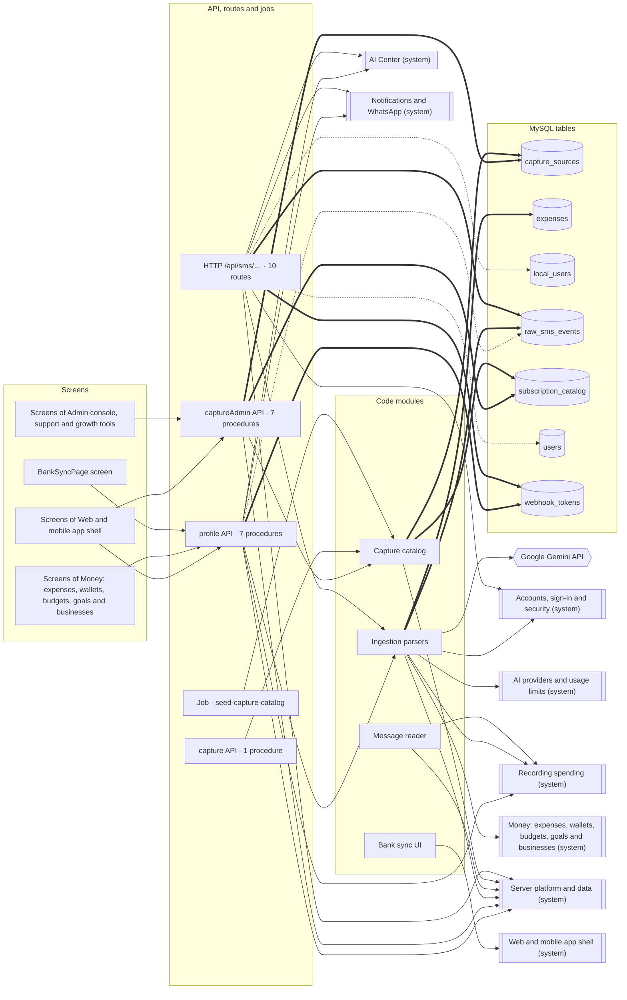
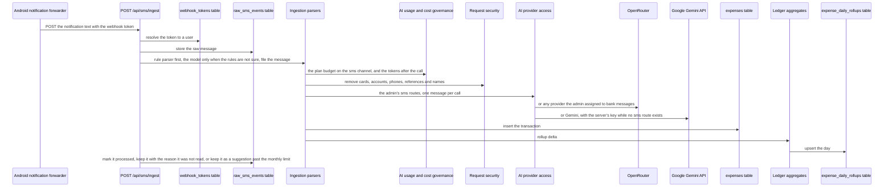

<!-- GENERATED by `npm run atlas` from the source code and docs/architecture/systems.json. Do not edit: the next run overwrites this file. -->

# Bank and wallet messages

Receives bank and wallet notifications forwarded by the Android companion app or a personal iOS Shortcut, and parses them with rules first and a model second.

How it works: [docs/systems/bank-messages.md](../../systems/bank-messages.md) · بالعربي: [docs/ar/systems/bank-messages.md](../../ar/systems/bank-messages.md) · [All systems](README.md)

## What it is made of

Solid arrows: calls and uses. Thick arrows: writes a table. Dotted arrows: reads a table. A double-bordered box is another system this one depends on.

## Journeys

### a bank message forwarded from a phone

The Android companion or an iOS Shortcut posts message text with the user’s webhook token. The route resolves the token, refuses a duplicate, stores the raw message and parses it with the rule parser. When the rules are not sure, a model may read it (decision 0025): only if the admin’s switch is on, the plan budget and the daily USD cap allow it, on text with cards, accounts, phones, references and names removed, through the models the admin assigned to bank messages (the server’s Gemini key until then), one message of one user per call, with the reply checked against a versioned contract. A skipped model or a discarded reply leaves the rules’ reading, or the raw message kept with its reason. Within the plan’s monthly limit it files the message (a known merchant takes its category) and writes the transaction, its rollup delta and the raw message status in one database transaction. Past the limit the rules alone read it and the raw message is kept as a suggestion the user confirms from the home screen.

Drawn in `docs/architecture/flows/sms-ingest.c4`; in the interactive map it is the view `flow_sms_ingest`.

## Code modules

| Module | What it does | Files |
| --- | --- | --- |
| `capture-catalog` — Capture catalog | The banks, wallets, payment networks, fintech and messaging apps whose notifications are read, and the subscriptions recognised in card charges: the shipped seed, the per-process copy that reloads on an admin change, and the lookups by Android app, SMS sender and merchant name. | 3 |
| `capture-reader` — Message reader | Layer one of capture, before any model: reads a bank, wallet or payment notification into what happened, which way, how much and in what currency, with which card and with whom, when, how sure it is and why (normalization with a position map, piece finders, an Arabic and English lexicon, sentences, money roles, kind and direction, the other side, the date), plus its benchmark corpus. | 12 |
| `ingestion-parsers` — Ingestion parsers | Bank SMS parsing (rules first, then a model through the admin's sms routes behind a switch, the plan budget and a daily USD cap, on redacted text, with a versioned reply contract checked before use), the step that files a parsed message in the ledger (its category, the automatic save, and the suggestions kept over the monthly limit), and the generator of the personal iOS Shortcut. | 5 |
| `web-bank-sync` — Bank sync UI | The bank sync screens: iPhone Shortcut and Android companion setup, the digital wallet view shown once a phone is connected, and the SMS webhook settings panel. | 4 |

## API procedures

| Procedure | Kind | Builder | Reads | Writes | Screens that call it |
| --- | --- | --- | --- | --- | --- |
| `capture.sources` | query | `authedProcedure` | — | — | — |
| `captureAdmin.catalog` | query | `adminProcedure` | `capture_sources`, `subscription_catalog` | — | `Admin`, `More` |
| `captureAdmin.restoreSeed` | mutation | `adminProcedure` | `capture_sources`, `subscription_catalog` | `capture_sources`, `subscription_catalog` | `Admin`, `More` |
| `captureAdmin.saveSource` | mutation | `adminProcedure` | `capture_sources` | `capture_sources` | `Admin`, `More` |
| `captureAdmin.saveSubscription` | mutation | `adminProcedure` | `subscription_catalog` | `subscription_catalog` | `Admin`, `More` |
| `captureAdmin.setSourceStatus` | mutation | `adminProcedure` | `capture_sources` | `capture_sources` | `Admin`, `More` |
| `captureAdmin.setSubscriptionStatus` | mutation | `adminProcedure` | `subscription_catalog` | `subscription_catalog` | `Admin`, `More` |
| `captureAdmin.syncSeed` | mutation | `adminProcedure` | — | — | `Admin`, `More` |
| `profile.confirmSmsSuggestion` | mutation | `authedProcedure` | — | — | `Home` |
| `profile.dismissSmsSuggestion` | mutation | `authedProcedure` | — | — | `Home` |
| `profile.generateMagicCode` | mutation | `authedProcedure` | `webhook_tokens` | — | — |
| `profile.generateWebhookToken` | mutation | `authedProcedure` | — | `webhook_tokens` | `BankSyncPage`, `More` |
| `profile.getSmsLogs` | query | `authedProcedure` | `raw_sms_events` | — | `BankSyncPage`, `More` |
| `profile.getSmsSuggestions` | query | `authedProcedure` | `raw_sms_events` | — | `Home` |
| `profile.getWebhookToken` | query | `authedProcedure` | `raw_sms_events`, `webhook_tokens` | — | `BankSyncPage`, `More`, `WalletsPage` |

## HTTP routes, WebSockets and scheduled jobs

| Entry point | Kind | Declared in |
| --- | --- | --- |
| `GET /api/sms/android-connect` | http | `api/sms-router.ts` |
| `POST /api/sms/android-status` | http | `api/sms-router.ts` |
| `POST /api/sms/exchange` | http | `api/sms-router.ts` |
| `POST /api/sms/ingest` | http | `api/sms-router.ts` |
| `GET /api/sms/logs` | http | `api/sms-router.ts` |
| `GET /api/sms/metrics` | http | `api/sms-router.ts` |
| `GET /api/sms/shortcut-download` | http | `api/sms-router.ts` |
| `GET /api/sms/token` | http | `api/sms-router.ts` |
| `POST /api/sms/token/generate` | http | `api/sms-router.ts` |
| `GET /api/sms/unparsed` | http | `api/sms-router.ts` |
| `seed-capture-catalog` | job, once at boot | `api/boot.ts` |

## Data

Who in this system writes or reads each table: procedures, routes, jobs and code modules.

| Table | Storage class | Written by | Read by |
| --- | --- | --- | --- |
| `capture_sources` | A | `capture-catalog`, `captureAdmin.restoreSeed`, `captureAdmin.saveSource`, `captureAdmin.setSourceStatus` | `capture-catalog`, `captureAdmin.catalog`, `captureAdmin.restoreSeed`, `captureAdmin.saveSource`, `captureAdmin.setSourceStatus` |
| `expenses` | B | `ingestion-parsers` | — |
| `local_users` | A | — | `POST /api/sms/ingest` |
| `raw_sms_events` | E | `POST /api/sms/ingest`, `ingestion-parsers` | `GET /api/sms/logs`, `GET /api/sms/metrics`, `GET /api/sms/unparsed`, `POST /api/sms/ingest`, `ingestion-parsers`, `profile.getSmsLogs`, `profile.getSmsSuggestions`, `profile.getWebhookToken` |
| `subscription_catalog` | A | `capture-catalog`, `captureAdmin.restoreSeed`, `captureAdmin.saveSubscription`, `captureAdmin.setSubscriptionStatus` | `capture-catalog`, `captureAdmin.catalog`, `captureAdmin.restoreSeed`, `captureAdmin.saveSubscription`, `captureAdmin.setSubscriptionStatus` |
| `users` | A | — | `POST /api/sms/ingest` |
| `webhook_tokens` | D | `GET /api/sms/android-connect`, `POST /api/sms/token/generate`, `profile.generateWebhookToken` | `GET /api/sms/android-connect`, `GET /api/sms/shortcut-download`, `GET /api/sms/token`, `POST /api/sms/android-status`, `POST /api/sms/exchange`, `POST /api/sms/ingest`, `profile.generateMagicCode`, `profile.getWebhookToken` |

## Outside systems

| System | Kind | Modules |
| --- | --- | --- |
| Google Gemini API | ai-provider | `ingestion-parsers` |

## Other systems

Depends on: [Accounts, sign-in and security](accounts.md), [Admin console, support and growth tools](admin.md), [AI Center](ai-center.md), [AI providers and usage limits](ai-platform.md), [Recording spending](expense-capture.md), [Reports, insights and the smart profile](insights.md), [Money: expenses, wallets, budgets, goals and businesses](money.md), [Notifications and WhatsApp](notifications.md), [Server platform and data](platform.md), [Web and mobile app shell](web-app.md).

Used by: [Admin console, support and growth tools](admin.md), [Money: expenses, wallets, budgets, goals and businesses](money.md), [Server platform and data](platform.md), [Web and mobile app shell](web-app.md).

## Environment variables

| Variable | Validated in api/lib/env.ts | Read by |
| --- | --- | --- |
| `GEMINI_API_KEY` | yes | `api/lib/sms-ai-parser.ts` |

## Source its explanation describes

When any of it changes, `npm run agent:finish` asks for a new check of `docs/systems/bank-messages.md`. A name after `#` is one procedure, route or job of a file that several systems share; `rest-of-file` is the rest of such a file.

42 files and declarations

- `.github/workflows/build-apk.yml`
- `android-app/app/build.gradle`
- `android-app/app/src/main/AndroidManifest.xml`
- `android-app/app/src/main/java/com/smartspend/sync/DeepLinkActivity.kt`
- `android-app/app/src/main/java/com/smartspend/sync/SyncService.kt`
- `api/boot.ts#job:seed-capture-catalog`
- `api/capture-admin-router.ts`
- `api/capture-router.ts`
- `api/lib/capture/catalog.ts`
- `api/lib/capture/reader/clauses.ts`
- `api/lib/capture/reader/counterparty.ts`
- `api/lib/capture/reader/explain.ts`
- `api/lib/capture/reader/fixtures.ts`
- `api/lib/capture/reader/kind.ts`
- `api/lib/capture/reader/lexicon.ts`
- `api/lib/capture/reader/normalize.ts`
- `api/lib/capture/reader/read.ts`
- `api/lib/capture/reader/roles.ts`
- `api/lib/capture/reader/spans.ts`
- `api/lib/capture/reader/types.ts`
- `api/lib/capture/reader/when.ts`
- `api/lib/capture/seed-sources.ts`
- `api/lib/capture/seed-subscriptions.ts`
- `api/lib/shortcut-generator.ts`
- `api/lib/sms-ai-contract.ts`
- `api/lib/sms-ai-parser.ts`
- `api/lib/sms-rule-parser.ts`
- `api/profile-router.ts#profile.confirmSmsSuggestion`
- `api/profile-router.ts#profile.dismissSmsSuggestion`
- `api/profile-router.ts#profile.generateMagicCode`
- `api/profile-router.ts#profile.generateWebhookToken`
- `api/profile-router.ts#profile.getSmsLogs`
- `api/profile-router.ts#profile.getSmsSuggestions`
- `api/profile-router.ts#profile.getWebhookToken`
- `api/profile-router.ts#rest-of-file`
- `api/services/sms-ledger.ts`
- `api/sms-router.ts`
- `src/components/bank-sync/AndroidSetupFlow.tsx`
- `src/components/bank-sync/IosSetupFlow.tsx`
- `src/components/bank-sync/SmsSuggestionsCard.tsx`
- `src/components/settings/SmsWebhookSettings.tsx`
- `src/pages/BankSyncPage.tsx`

