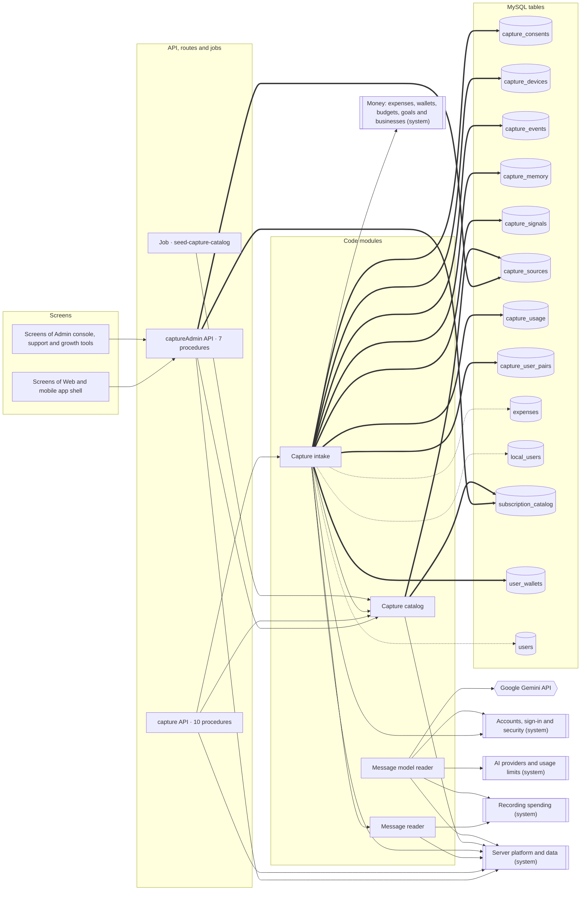

<!-- GENERATED by `npm run atlas` from the source code and docs/architecture/systems.json. Do not edit: the next run overwrites this file. -->

# Bank and wallet messages

Automatic capture of bank and wallet messages, being rebuilt: the catalog of banks, wallets and subscriptions the admin edits, the reader that reads a message without a model, and the admin's model for what the reader is unsure of. Nothing receives messages yet.

How it works: [docs/systems/bank-messages.md](../../systems/bank-messages.md) · بالعربي: [docs/ar/systems/bank-messages.md](../../ar/systems/bank-messages.md) · [All systems](README.md)

## What it is made of

Solid arrows: calls and uses. Thick arrows: writes a table. Dotted arrows: reads a table. A double-bordered box is another system this one depends on.

## Code modules

| Module | What it does | Files |
| --- | --- | --- |
| `capture-ai-reader` — Message model reader | Layer two of capture: reads one bank or wallet message with the model the admin assigned to bank messages (the server's Gemini key until then), behind the admin's switch, the plan budget and a daily USD cap, on condensed and redacted text, one message of one user per call, with the reply checked against a versioned contract before it is used. Nothing calls it yet: the intake reads with the reader only. | 2 |
| `capture-catalog` — Capture catalog | The banks, wallets, payment networks, fintech and messaging apps whose notifications are read, and the subscriptions recognised in card charges: the shipped seed, the per-process copy that reloads on an admin change, and the lookups by Android app, SMS sender and merchant name. | 3 |
| `capture-intake` — Capture intake | Where captured bank and wallet notifications come in (decision 0028): the device tokens phones register while signed in and send with every request, the user's consents with their text version, the /api/capture/v1 routes (signals, config, a notification's button), the server's filter that keeps only what the reader reads as money that moved, the rules that merge the signals of one payment into one event (decision 0029), the user's memory of where each merchant and person is filed and which banks and kinds are recorded on their own (decision 0030), the monthly limit with the payments held over it, the notice written in the phone's language, where each kind would be filed, and the user's answer, which writes the ledger through the ledger writer. | 6 |
| `capture-reader` — Message reader | Layer one of capture, before any model: reads a bank, wallet or payment notification into what happened, which way, how much and in what currency, with which card and with whom, when, how sure it is and why (normalization with a position map, piece finders, an Arabic and English lexicon, sentences, money roles, kind and direction, the other side, the date), plus its benchmark corpus. | 12 |

## API procedures

| Procedure | Kind | Builder | Reads | Writes | Screens that call it |
| --- | --- | --- | --- | --- | --- |
| `capture.answer` | mutation | `authedProcedure` | — | — | — |
| `capture.autoOffers` | query | `authedProcedure` | — | — | — |
| `capture.devices` | query | `authedProcedure` | — | — | — |
| `capture.pending` | query | `authedProcedure` | — | — | — |
| `capture.registerDevice` | mutation | `authedProcedure` | — | — | — |
| `capture.revokeDevice` | mutation | `authedProcedure` | — | — | — |
| `capture.setAuto` | mutation | `authedProcedure` | — | — | — |
| `capture.setConsent` | mutation | `authedProcedure` | — | — | — |
| `capture.sources` | query | `authedProcedure` | — | — | — |
| `capture.status` | query | `authedProcedure` | — | — | — |
| `captureAdmin.catalog` | query | `adminProcedure` | `capture_sources`, `subscription_catalog` | — | `Admin`, `More` |
| `captureAdmin.restoreSeed` | mutation | `adminProcedure` | `capture_sources`, `subscription_catalog` | `capture_sources`, `subscription_catalog` | `Admin`, `More` |
| `captureAdmin.saveSource` | mutation | `adminProcedure` | `capture_sources` | `capture_sources` | `Admin`, `More` |
| `captureAdmin.saveSubscription` | mutation | `adminProcedure` | `subscription_catalog` | `subscription_catalog` | `Admin`, `More` |
| `captureAdmin.setSourceStatus` | mutation | `adminProcedure` | `capture_sources` | `capture_sources` | `Admin`, `More` |
| `captureAdmin.setSubscriptionStatus` | mutation | `adminProcedure` | `subscription_catalog` | `subscription_catalog` | `Admin`, `More` |
| `captureAdmin.syncSeed` | mutation | `adminProcedure` | — | — | `Admin`, `More` |

## HTTP routes, WebSockets and scheduled jobs

| Entry point | Kind | Declared in |
| --- | --- | --- |
| `seed-capture-catalog` | job, once at boot | `api/boot.ts` |

## Data

Who in this system writes or reads each table: procedures, routes, jobs and code modules.

| Table | Storage class | Written by | Read by |
| --- | --- | --- | --- |
| `capture_consents` | A | `capture-intake` | `capture-intake` |
| `capture_devices` | A | `capture-intake` | `capture-intake` |
| `capture_events` | E | `capture-intake` | `capture-intake` |
| `capture_memory` | A | `capture-intake` | `capture-intake` |
| `capture_signals` | E | `capture-intake` | `capture-intake` |
| `capture_sources` | A | `capture-catalog`, `captureAdmin.restoreSeed`, `captureAdmin.saveSource`, `captureAdmin.setSourceStatus` | `capture-catalog`, `captureAdmin.catalog`, `captureAdmin.restoreSeed`, `captureAdmin.saveSource`, `captureAdmin.setSourceStatus` |
| `capture_usage` | C | `capture-intake` | `capture-intake` |
| `capture_user_pairs` | A | `capture-intake` | `capture-intake` |
| `expenses` | B | — | `capture-intake` |
| `local_users` | A | — | `capture-intake` |
| `subscription_catalog` | A | `capture-catalog`, `captureAdmin.restoreSeed`, `captureAdmin.saveSubscription`, `captureAdmin.setSubscriptionStatus` | `capture-catalog`, `captureAdmin.catalog`, `captureAdmin.restoreSeed`, `captureAdmin.saveSubscription`, `captureAdmin.setSubscriptionStatus` |
| `user_wallets` | A | `capture-intake` | `capture-intake` |
| `users` | A | — | `capture-intake` |

## Outside systems

| System | Kind | Modules |
| --- | --- | --- |
| Google Gemini API | ai-provider | `capture-ai-reader` |

## Other systems

Depends on: [Accounts, sign-in and security](accounts.md), [AI providers and usage limits](ai-platform.md), [Recording spending](expense-capture.md), [Money: expenses, wallets, budgets, goals and businesses](money.md), [Server platform and data](platform.md).

Used by: [Accounts, sign-in and security](accounts.md), [Admin console, support and growth tools](admin.md), [Money: expenses, wallets, budgets, goals and businesses](money.md), [Server platform and data](platform.md), [Web and mobile app shell](web-app.md).

## Environment variables

| Variable | Validated in api/lib/env.ts | Read by |
| --- | --- | --- |
| `GEMINI_API_KEY` | yes | `api/lib/capture/ai-reader.ts` |
| `JWT_SECRET` | yes | `api/lib/capture/memory.ts` |

## Source its explanation describes

When any of it changes, `npm run agent:finish` asks for a new check of `docs/systems/bank-messages.md`. A name after `#` is one procedure, route or job of a file that several systems share; `rest-of-file` is the rest of such a file.

26 files and declarations

- `api/boot.ts#job:seed-capture-catalog`
- `api/capture-admin-router.ts`
- `api/capture-router.ts`
- `api/capture-v1-routes.ts`
- `api/lib/capture/ai-reader.ts`
- `api/lib/capture/catalog.ts`
- `api/lib/capture/consent.ts`
- `api/lib/capture/devices.ts`
- `api/lib/capture/events.ts`
- `api/lib/capture/intake.ts`
- `api/lib/capture/memory.ts`
- `api/lib/capture/reader/clauses.ts`
- `api/lib/capture/reader/counterparty.ts`
- `api/lib/capture/reader/explain.ts`
- `api/lib/capture/reader/fixtures.ts`
- `api/lib/capture/reader/kind.ts`
- `api/lib/capture/reader/lexicon.ts`
- `api/lib/capture/reader/normalize.ts`
- `api/lib/capture/reader/read.ts`
- `api/lib/capture/reader/roles.ts`
- `api/lib/capture/reader/spans.ts`
- `api/lib/capture/reader/types.ts`
- `api/lib/capture/reader/when.ts`
- `api/lib/capture/seed-sources.ts`
- `api/lib/capture/seed-subscriptions.ts`
- `api/lib/sms-ai-contract.ts`

